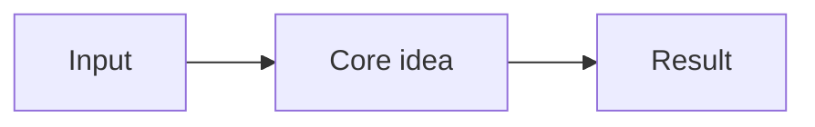

<!--
Copy this file to papers/<arxiv-id-or-year>-<short-slug>/README.md.
Each layer below should be readable on its own: stop at any layer and still come away with the key points.
Diagrams: use Mermaid fenced blocks (```mermaid) so GitHub renders them inline.
-->

# <Paper title>

| | |
|---|---|
| **Authors** | <names (affiliations)> |
| **Published** | <YYYY-MM-DD> · <venue / arXiv category> |
| **Link** | [arXiv:<id>](https://arxiv.org/abs/<id>) · [PDF](https://arxiv.org/pdf/<id>) |
| **License** | <e.g. CC BY 4.0> |
| **Tags** | `tag1` `tag2` |
| **Read on** | <YYYY-MM-DD> |
| **Verdict** | <one line: why it matters / how much to trust it> |

---

## Layer 1: TL;DR (30 seconds)

- **Problem:** <what gap the paper addresses>
- **Approach:** <what they did>
- **Result:** <headline finding>
- **So what:** <why I should care>

## Layer 2: The one diagram (2 minutes)



<2-3 sentences explaining the diagram.>

## Layer 3: Key findings

| # | Finding | Evidence |
|---|---|---|
| 1 | | |

## Layer 4: How it works (architecture and method)

<One subsection per component. Prefer a diagram plus a few bullets over prose.>

## Layer 5: Numbers worth remembering

| Metric | Value | Context / caveat |
|---|---|---|

## Critique and limits

- <threats to validity, what is not shown, my doubts>

## Takeaways for my work

- <what I would apply or change, or what I would test>

## Open questions

- <things to follow up on>

## Glossary

| Term | Meaning |
|---|---|

## Related

- <papers or links this connects to>
