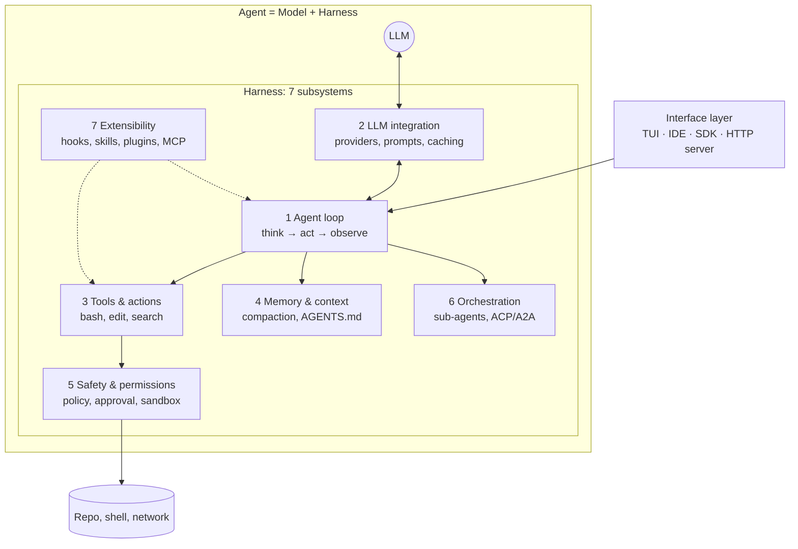
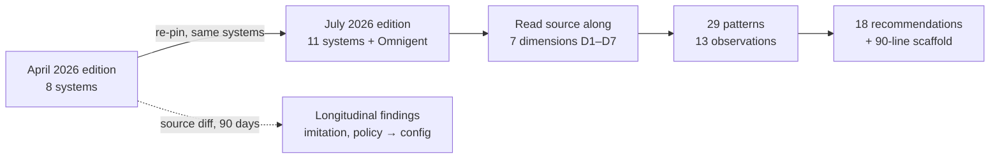
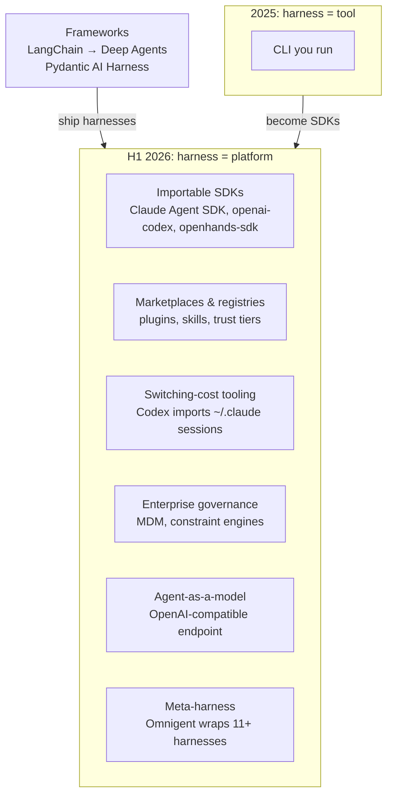
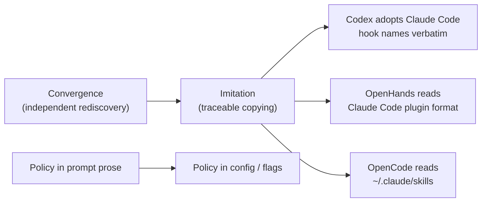
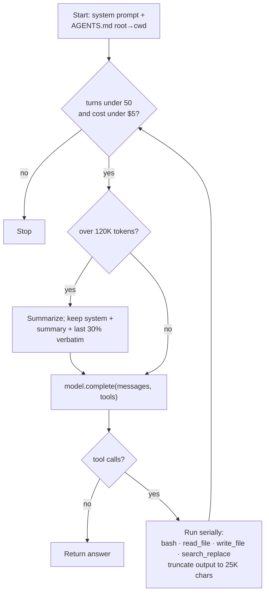

# Harness Engineering: Anatomy, Architecture, and Evolution of Coding Agents

*A Source-Code Study of Eleven Systems*

| | |
|---|---|
| **Authors** | Paul Barbaste (Inclusive Brains, Wavestone AI Lab), Tristan Darrigol, Germain Vu, Tom Wiltberger (Wavestone AI Lab) |
| **Published** | 2026-07-15 · arXiv cs.SE |
| **Link** | [arXiv:2609.00006](https://arxiv.org/abs/2609.00006) · [PDF](https://arxiv.org/pdf/2609.00006) · [HTML](https://arxiv.org/html/2609.00006) |
| **License** | CC BY 4.0 |
| **Tags** | `coding-agents` `harness-engineering` `agent-architecture` `MCP` `skills` `multi-agent` `survey` |
| **Read on** | 2026-11-12 |
| **Verdict** | The best map so far of how production coding agents are actually built. It is descriptive, not a benchmark, and its inventory claims go stale within weeks. |

> Companion page: **[subsystems.md](subsystems.md)** is a deep dive with one diagram and one comparison table per subsystem.

---

## Layer 1: TL;DR (30 seconds)

- **Problem:** "Harness engineering" (everything around the LLM: loop, tools, context, safety, orchestration, extensions) became a named discipline in early 2026, but nobody had grounded it in production source code.
- **Approach:** The authors read the source of **11 coding agents** (Claude Code, Codex CLI, Gemini CLI, Mistral Vibe, OpenHands, Aider, Mini-SWE-Agent, Hermes, Pi, OpenCode, OpenClaw), plus one meta-harness (Omnigent). They compared them along **7 subsystems**, then re-diffed 8 of them after 90 days.
- **Result:** They found **29 patterns** and **13 observations**. Two things are absent everywhere: **no agent framework** (LangChain and the like) and **no vector RAG over code**. **Skills (9/11) now lead MCP (8/11).** Harnesses are copying each other verbatim.
- **So what:** The harness went from **tool to platform** in the first half of 2026, with SDKs, marketplaces, importers, governance and meta-harnesses. The paper closes with **18 recommendations** and a **90-line minimal harness**.

## Layer 2: The one diagram (2 minutes)



Every harness, from Mini-SWE-Agent (100 lines) to Codex (1.1M lines of Rust), takes some position on each of these 7 subsystems, even if that position is "absent on purpose." The extra code in the big systems mostly goes to **safety, UX, extensibility and clients**, not to finishing tasks.

## Layer 3: Key findings (the 13 observations, compressed)

| # | Observation | Evidence |
|---|---|---|
| 1 | **Size does not predict benchmark score.** Code size spans 3 orders of magnitude, yet loop sophistication does not predict SWE-bench results. | Mini-SWE-Agent reports 74%+ and OpenHands 77.6% (both self-reported). About 3/5 of OpenCode's code is clients. |
| 2 | **Provider-native tricks (caching, thinking, per-model prompts) are open to anyone who pays the per-provider code cost.** Vendors uniquely keep the *update loop*. | Hermes, Pi and OpenCode reach full caching from multi-provider code. Codex re-tunes prompts server-side per model release. |
| 3 | **Prompt rhetoric converges, then thins as trust grows.** | Anti-gold-plating appears in 6 scaffolds. "Never commit" was universal in April, but by July Mistral Vibe had reversed it and Codex 5.6 had dropped it. None of the 11 prompts has policy-level refusal language. |
| 4 | **Edit strategy is a top driver of accuracy**, and choosing the format per model has spread beyond Aider. | Aider uses 13 formats. OpenCode gives GPT models a patch DSL and other models string replacement. Mistral Vibe moved from fuzzy to exact matching. |
| 5 | **Persistent memory, not compaction, is now where the differences are.** | 7/11 use threshold compaction. Memory follows 4 governance models: agent-maintained (Codex), human-gated (Gemini), bounded direct writes (Hermes), pre-turn recall (OpenClaw). |
| 6 | **An OS sandbox is a choice, not a side effect of scale.** | Hermes (642K lines) and OpenCode (578K lines) have no OS isolation. Codex vendors bubblewrap. |
| 7 | **Coordinator-worker emerged independently** in 7+ systems, each optimizing something different. | Claude Code optimizes cost (cache-sharing forks). Codex optimizes isolation (thread tree). Gemini optimizes portability. Mistral Vibe optimizes simplicity. |
| 8 | **Skills overtook MCP.** | 9/11 vs 8/11. 8 of the 9 adopters load skills lazily. Registries, trust tiers and agent-authored skills have appeared. |
| 9 | **The two absences:** no agentic framework and no embedding RAG over code, across about 4M lines. | Gemini CLI does not even use Google's ADK or Genkit. Retrieval everywhere is ripgrep, glob, tree-sitter and Markdown context files. |
| 10 | **Anthropic's "effective agents" blog series predicted the observed architectures.** | Hand-rolled loops, few tools, just-in-time retrieval, orchestrator-workers. The paper leaves open whether this is causation. |
| 11 | **ACP gained a third role: harness hosting.** | ACP ships in 6/11 for editors and for hosting (OpenHands runs Claude Code, Codex or Gemini as backends). A2A is in Gemini CLI only. Sub-agents stay in-process. |
| 12 | **The platform turn is complete.** | SDKs, marketplaces, cross-vendor session importers, MDM governance, the agent served behind an OpenAI-compatible endpoint, and a meta-harness. |
| 13 | **A 90-line harness implements 10 of the 18 recommendations**, with no framework, RAG, sandbox or multi-agent. | Listing 3 in the paper; a skeleton is below. |

## Layer 4: How it works

### 4a. The study design



- **Method:** read source and grep manifests. **No runtime benchmarks**; every benchmark number in the paper is self-reported by the vendors.
- The **Claude Code** analysis uses a **circulated March 2026 source snapshot**, not an official release. The authors call it the weakest point for reproducibility.

### 4b. The corpus at a glance

| System | Lang | Scale | Tools | Sandbox | Signature move |
|---|---|---|---|---|---|
| Mini-SWE-Agent | Python | ~100 LoC core | 1 (bash) | Docker opt. | The floor: all 7 subsystems, minimally |
| Pi | TS | Medium | 7 | None (by design) | Everything is an extension; session tree |
| Aider | Python | Small | 13 edit formats | None | Polymorphic edits; ranked repo map |
| Mistral Vibe | Python | Small | 12+ | Worktree opt. | Middleware-pipeline loop |
| OpenCode | TS | Large (578K) | 17 | None (policy) | Client/server; tree-sitter permissions |
| OpenHands | Python | Medium | 25+ | Docker/remote | Event sourcing; hosts rival harnesses |
| Codex | Rust | Very large (1.1M) | 25–30 | Native, 3 OSes | Agent-maintained memory; Guardian |
| Gemini CLI | TS | Very large | 35+ | Native, 3 OSes | Model router; only A2A server |
| Claude Code | TS | Large | 43 | Opt-in runtime | Deferred tools; cache-sharing forks |
| Hermes | Python | Very large (642K) | 69 | 6 backends | Self-improving skills; verify-on-stop |
| OpenClaw | TS | Large | 109+ | None | Multi-channel gateway (non-SWE contrast) |

### 4c. The platform turn



**The harness–framework merger.** Harnesses never adopted frameworks. Instead they *replaced* them and became importable themselves. Meanwhile LangChain built a harness (Deep Agents) that independently copies the corpus conventions: SKILL.md, AGENTS.md, sub-agents, a todo tool. The question "which framework?" has become "which harness?"

### 4d. Ninety days of evolution (April → July 2026)



- **Patterns spread in weeks.** Deferred tool loading went from 1 system to 3. Read-only plan modes went from 2 to all 4 vendor systems. Checkpointing went from 1 to 3.
- **Codex nearly doubled** in one quarter, from 621K to 1.12M lines of Rust. Mistral Vibe grew 77%.
- **Lesson:** *inventory* claims (tool counts, versions) decay in weeks. *Structural* claims (loop taxonomy, the two absences) have held up.

### 4e. The 90-line minimum viable harness (Listing 3, condensed)



```python
# skeleton of the paper's Listing 3 (see the paper for the full 90 lines)
TOOLS = {"bash": tool_bash, "read_file": tool_read_file,
         "write_file": tool_write_file, "search_replace": tool_search_replace}  # unique-match replace

async def run(self, task):
    self.messages = [{"role": "system", "content": f"You are a SWE agent.\n\n{discover_context()}"},
                     {"role": "user", "content": task}]
    while True:
        await self._check_limits(); await self._maybe_compact()   # middleware-style policies
        resp = await self.model.complete(self.messages, tools=tool_schemas)
        self.messages.append(resp)
        if not resp.get("tool_calls"): return resp.get("content", "")
        for call in resp["tool_calls"]:                           # serial execution
            out = TOOLS[call["name"]](**call["args"])
            self.messages.append({"role": "tool", "tool_call_id": call["id"], "content": _truncate(out)})
```

It deliberately leaves out a sandbox, multi-agent support and MCP/skills. The advice is to add each one only when an observed failure needs it.

## Layer 5: Numbers worth remembering

| Metric | Value | Context / caveat |
|---|---|---|
| Lines of code audited | ~4M | Python, TypeScript and Rust across 12 trees |
| Systems using an agent framework | **0 / 11** | Gemini CLI uses neither of Google's own |
| Systems using embedding RAG for code | **0 / 11** | OpenClaw uses embeddings for *chat* memory only |
| Skills vs MCP adoption | **9/11 vs 8/11** | Pi broke the tie: it has skills but rejects MCP |
| ACP adoption | 6/11 | Roles: editor, harness hosting (A2A for mesh is separate) |
| Threshold compaction | 7/11 | The de facto standard |
| Claude Code deferred tool loading | ~40% fewer prompt tokens | Kicks in at 43 tools |
| Claude Code auto-compact buffer | 13K tokens | Restores up to 5 files (50K budget) afterwards |
| Gemini CLI compaction | at 50%, keeps last 30% | |
| Mini-SWE-Agent on SWE-bench Verified | 74%+ | Self-reported; different models and dates |
| Codex growth in one quarter | 621K → 1.12M LoC | 89 → 126 crates |
| Multi-agent token cost | ~15× chat | From Anthropic's research-system post |
| Deferred-tools threshold (Rec. 4) | >15 tools | Below that, the indirection is not worth it |

## The 18 recommendations (cheat sheet)

| # | Area | Recommendation |
|---|---|---|
| 1 | Loop | Start with a linear `while`. Move to a middleware pipeline once you have 3+ turn policies. |
| 2 | Provider | Vendors: couple tightly and add a generic fallback. Others: keep per-model metadata centrally. |
| 3 | Tools | Start with bash only. Add tools only for failures you have observed. |
| 4 | Tools | Above 15 tools, use deferred loading plus tool search. |
| 5 | Editing | Exact unique-substring edits for frontier models; a fuzzy cascade for weaker ones. **Never edit by line number.** |
| 6 | Context | Auto-discover hierarchical Markdown context files, and read your neighbors' filenames too (AGENTS.md, CLAUDE.md…). |
| 7 | Context | Compact at a buffer below the window, keep the recent tail verbatim, merge summaries incrementally, and also compact reactively on overflow. |
| 8 | Context | No RAG over code; use ripgrep, glob and tree-sitter. |
| 9 | Safety | Dev tool: PLAN / DEFAULT / YOLO modes plus permission patterns. |
| 10 | Safety | Enterprise: OS sandbox, policy-as-code and audit trails. |
| 11 | Safety | Express policy as data, and keep a hard floor under YOLO. |
| 12 | Multi-agent | Stay single-agent until a breadth-first exploration phase needs parallelism. |
| 13 | Multi-agent | Ship an ACP server; keep sub-agents in-process. |
| 14 | Extensibility | Skills for know-how, MCP for external integrations, in that order. |
| 15 | Anti-pattern | Don't build the agent runtime on LangChain, CrewAI or similar. |
| 16 | Anti-pattern | Don't build a vector index over code unless you can show it beats ripgrep. |
| 17 | Anti-pattern | Don't wrap every SaaS endpoint 1:1 as a tool. |
| 18 | Anti-pattern | Don't over-engineer stuck detection, but do ship the cheap caps. |

## Critique and limits

- **Source reading, not measurement.** There is no controlled cross-system benchmark. All SWE-bench numbers are self-reported, and the "size doesn't predict score" claim rests on numbers that cannot be compared.
- **Claude Code evidence is a publicly circulated source snapshot** from March 2026, not an official release; the shipping binary (2.1.206) has moved on since then.
- **The framework-absence check is conservative.** It used manifest and import greps only, with no tracing of dynamic imports or plugins. The authors would be "surprised, but not shocked" by a counterexample.
- **The Anthropic-alignment claim (Observation 10) is correlation only.** No engineers were interviewed.
- **Fast decay.** By the authors' own admission, three April observations had to be revised after 90 days. Treat the tool counts and version cells as already stale.
- **Disclosure:** the paper was written with substantial help from Claude via Claude Code, which is worth knowing given how central Claude Code is to the comparisons.
- **The scaffold–capability frontier** (a concave curve of scaffold complexity against success rate) is offered explicitly as an intuition, not a result.

## Takeaways for building agents

- **Default stack:** a hand-rolled loop, 4 tools, AGENTS.md discovery, threshold compaction and hard caps. Add more only in response to observed failures.
- **Pick the edit contract to match the model.** Exact match for frontier models, a fuzzy cascade otherwise. Tool design matters more than prompt prose; the AHE ablation found that the system prompt alone *regresses* performance.
- **Ship skills before MCP** for procedural knowledge, and lazy-load them.
- **Put safety rules in config, not in prompt prose**, and keep an un-bypassable floor.
- **Interop is cheap leverage.** Read other harnesses' file conventions and expose ACP; hosts and meta-harnesses will consume you.
- **The moat is the ecosystem surface, not the loop.** Differentiators get copied within weeks.

## Open questions

- Would a matched-model, matched-task benchmark show *any* completion gain from production scaffolding?
- Will harnesses consolidate, fragment into interoperable runtimes, or be commoditized from above by meta-harnesses?
- Is the convergence on Anthropic's guidance causal, or just shared empirical reality?
- Is there a real domain where code RAG beats ripgrep plus tree-sitter, for example very large monorepos?

## Glossary

| Term | Meaning |
|---|---|
| Harness | Everything except the model: the loop, tools, context, safety, orchestration and extensions |
| Scaffold | The structural code (loop, registries) inside a harness; the paper uses it as a near-synonym |
| Meta-harness | An orchestrator over whole harnesses (Omnigent); it has no editing loop of its own |
| ACP | Agent Client Protocol: editor↔agent JSON-RPC (Zed), now also used for hosting harnesses |
| A2A | Agent-to-Agent protocol, for cross-vendor agent meshes (Gemini CLI only) |
| Skill | A `SKILL.md` directory with YAML frontmatter and instructions/scripts, loaded on demand |
| Deferred loading | Tools or skills hidden from the prompt until found through a search tool |
| Compaction | LLM summarization of history when the context nears its limit |
| Verify-on-stop | A guard that refuses "done" if code changed without fresh test evidence (Hermes) |
| Harness mimicry | A client presenting a first-party harness's identity to use its subscription backend (Pi) |
| JIT context | Nested context files injected only when tools touch that subtree |

## Related

- Anthropic: *Building Effective Agents* (Dec 2024), *Effective Context Engineering* (Sep 2025), *Writing Effective Tools*, *How We Built Our Multi-Agent Research System*
- Rombaut, *Inside the Scaffold*: a source taxonomy of 13 open-source scaffolds
- Lin et al., *Agentic Harness Engineering* (AHE): auto-evolved harness reaching 71.9% on SWE-bench Verified
- Macedo: the first operational definition of a harness
- SWE-agent (ACI), CodeAct, ReAct, Agentless
