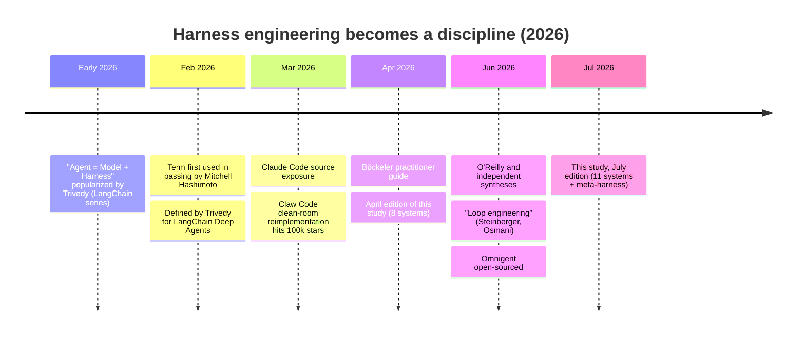
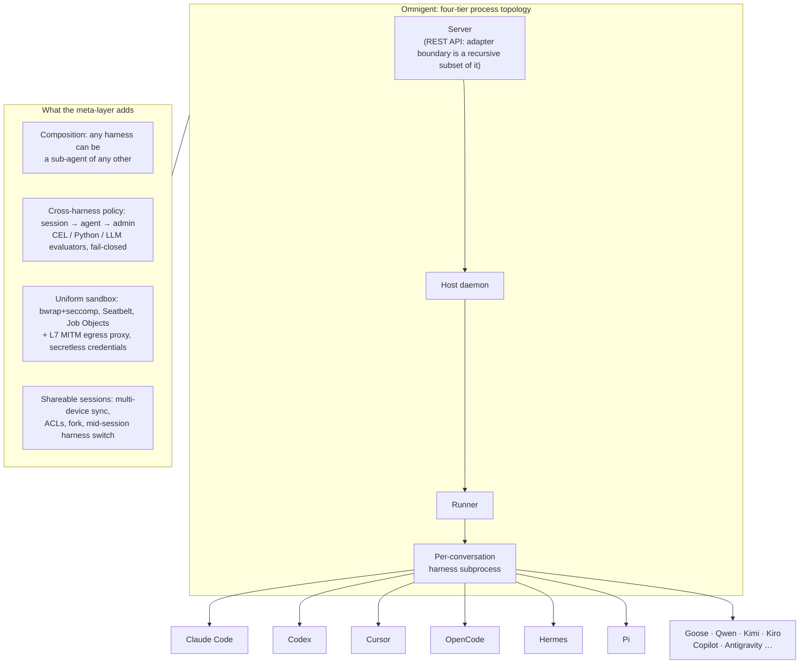
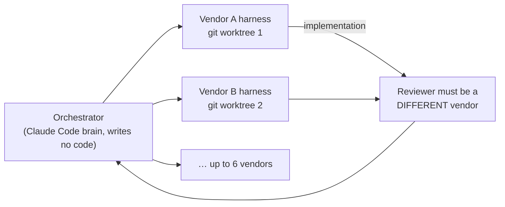

# Landscape, corpus and the meta-harness: Harness Engineering (arXiv:2609.00006)

← Back to the [main note](README.md). Covers §2 (definition and genealogy), §3 (related work and the 2026 landscape), §4 (methodology), §14.4 (Omnigent) and the ecosystem data from §17.

---

## 1. Definition and genealogy (§2)

> **Agent = Model + Harness.** The harness is everything except the model. **Harness engineering** is the discipline of designing and evolving it.

**The academic wave:**
- Lin et al., *Agentic Harness Engineering*: automates harness evolution.
- HARBOR: optimizes harnesses against benchmarks.
- Wang et al.: treat code itself as the harness substrate.
- Rombaut: source taxonomy of 13 open-source scaffolds.
- Macedo: the first operational definition, with necessary and sufficient conditions. This paper adopts Macedo's core definition.

**Irony the paper notes:** the term was coined inside LangChain, whose libraries appear in none of the 11 runtimes. LangChain's answer was to ship its own harness, Deep Agents.

### What a harness is *not* (§2.2)

| Confused with | Distinction |
|---|---|
| Scaffold | Near-synonym. Scaffold = structural code (loop, registries); harness = the shipped runtime that embeds it |
| Agentic framework | A framework is a library you import (LangChain, AutoGen, CrewAI); a harness is a runtime you work *inside*. The line is dissolving in 2026 |
| Evaluation harness | The SWE-bench "harness" wraps an agent to test it; an agent harness wraps a *model* to make it act. Opposite directions |
| Orchestrator / meta-harness | Coordinates harnesses from above and has no editing loop of its own (Omnigent) |

### Table 1: minimal vs maximal form of each subsystem

| Subsystem | Role | Minimal form | Maximal form |
|---|---|---|---|
| Agent loop | Alternates inference and action; owns stop conditions and recovery | Mini-SWE-Agent: linear `while` over one bash tool | OpenHands: event-sourced conversation over a persistent event log, with parallel action batches |
| LLM integration | Speaks provider protocols; assembles prompts; handles caching, thinking and routing | Mini-SWE-Agent: one LiteLLM call, one Jinja template | Hermes: 5 owned transports, 29 provider profiles. Codex: server-delivered model catalog |
| Tools & actions | Defines and runs what the agent can do, above all file editing | Mini-SWE-Agent: bash only | Claude Code: 43 typed tools with deferred loading. Codex: tool calls as V8-executed code |
| Memory & context | Rations the window; persists knowledge across turns and sessions | Mini-SWE-Agent: unbounded linear history | Codex: agent-maintained cross-session memory. Gemini CLI: graph-based context distillation |
| Safety & permissions | Decides what runs, what asks, what is forbidden; isolates execution | Mini-SWE-Agent: cost and step limits | Codex: policy rules + LLM approval reviewer + sandbox on 3 OSes |
| Orchestration | Spawns and coordinates sub-agents; connects to other agents | Aider: none (single-agent by design) | Claude Code: recursive composition. Omnigent: cross-vendor coordination |
| Extensibility | Lets users and ecosystems add capability | Mini-SWE-Agent: structural typing (Python protocols) | Pi: everything is an extension. Codex: marketplace-distributed plugins |

There are also **two cross-cutting surfaces**: the **interface layer** (TUI, CLI flags, IDE protocol, HTTP server, SDK) and the **session substrate** (transcripts, persistence, resume/fork).

---

## 2. Related work (§3)

| Thread | Key works | How this paper relates |
|---|---|---|
| Code agents | SWE-Bench, SWE-Agent (ACI), CodeAct, ReAct | Foundations of the loop and the tools |
| Second-wave SWE agents | AutoCodeRover (AST retrieval), MASAI (modular sub-agents), MAGIS and CodeR (role-based multi-agent), Lingma SWE-GPT (model trained with the loop), SWE-Search (MCTS), Diversity-Empowers-Intelligence, **Agentless** (a fixed pipeline competitive with agents), OpenHands paper | Agentless is the counterweight: is agentic complexity needed at all? |
| Auto-evolved harnesses | **AHE** (Lin et al.): bash-only seed → **71.9%** on SWE-bench Verified; transfers across model families | Ablation: tools, middleware and long-term memory carry the gain; **the system prompt alone regresses** |
| Architecture surveys | Conceptual surveys, Guo et al. (multi-agent), Liu et al. (SWE agents), AgentBench | They are conceptual; this paper grounds them in source code |
| Source taxonomies | **Rombaut, *Inside the Scaffold***: 13 open-source scaffolds, 12 dimensions; loops *compose primitives* | Open source only, excludes Claude Code. Its dimensions map onto D1/D3/D4/D5/D2 |
| Multi-agent SE | MetaGPT, ChatDev, AutoGen, Magentic-One, Chain-of-Agents | Several corpus systems use these patterns |
| Tool use | Toolformer, Gorilla, ToolLLM (16k+ APIs), AnyTool, **MCP** | MCP is adopted by 8/11 |
| Vendor guidance | Anthropic's 4 articles (Dec 2024 – Sep 2025) | Used as the reference baseline (see [synthesis.md](synthesis.md#anthropic-guidance-vs-observed-code-151)) |

---

## 3. The 2026 harness landscape (§3.7, Table 2)

These landscape claims come from vendor announcements, not source code.

### Three shifts since April 2026

```mermaid
flowchart TB
    A["Every vendor ships a harness<br/>and the market consolidates"] --> A1["Copilot CLI GA (Feb)"]
    A --> A2["Amazon Q Dev CLI → Kiro"]
    A --> A3["xAI Grok Build (May): closed Rust binary<br/>adopts AGENTS.md, MCP, skills, hooks, ACP"]
    A --> A4["SpaceX acquires xAI (Feb)<br/>announces $60B Cursor deal (Jun)"]
    A --> A5["Google: Gemini CLI → closed-source Antigravity CLI<br/>consumer tiers cut Jun 18"]
    B["Open-source centers of gravity"] --> B1["OpenCode: most-starred coding agent (~184k)"]
    B --> B2["Hermes: fastest-growing (~212k in 5 months)"]
    B --> B3["Goose donated to Linux Foundation AAIF (Apr)"]
    B --> B4["Claw Code: Claude Code clean-room reimplementation, 100k stars in days"]
    B --> B5["Chinese CLIs: Qwen Code, Kimi CLI, Trae Agent"]
    B --> B6["Aider in community-maintenance mode"]
    C["A meta-layer appears"] --> C1["Databricks Omnigent (Jun)"]
```

**Licensing turn:** Gemini CLI was Apache-2.0 with 105k stars. Its successor, Antigravity, is a closed Go binary. The paper's v0.50.0 pin therefore captures the *last major open-source state* of a provider-native harness lineage.

### Harnesses outside the corpus (Table 2)

| Harness | Vendor | OSS | Stars | Note |
|---|---|---|---|---|
| Antigravity CLI | Google | ✗ | — | Gemini CLI's successor; closed Go binary |
| Copilot CLI | GitHub/Microsoft | ✗ | — | GA Feb 2026; autopilot and fleet modes |
| Grok Build | xAI (SpaceX) | ✗ | — | Rust; plan-first loop; ACP server; AGENTS.md/MCP/skills |
| Cursor CLI | Anysphere | ✗ | — | IDE parity in the terminal; $60B acquisition pending |
| Kiro CLI | Amazon/AWS | ✗ | — | Formerly Q Developer; spec-driven |
| Cline | Cline Bot Inc. | ✓ | ~64k | 5M+ IDE installs; plan/act; Roo/Kilo forks |
| Goose | Block / Linux Foundation | ✓ | ~29k | Rust; native MCP |
| Claw Code | Community | ✓ | 100k+ | Clean-room reimplementation of Claude Code |
| Crush | Charmbracelet | ✓ | ~26k | Go, LSP-aware TUI |
| Qwen Code | Alibaba | ✓ | ~26k | Gemini CLI fork |
| Kimi CLI | Moonshot AI | ✓ | ~9k | Skills, MCP, agent swarm |
| Trae Agent | ByteDance | ✓ | ~12k | Research-friendly Python |
| Droid | Factory AI | ✗ | — | Terminal-Bench SOTA (Sep 2025); enterprise CI |
| Amp | Sourcegraph | ✗ | — | Ad-supported free tier |
| Continue CLI | Continue.dev | ✓ | ~30k | IDE + CLI; local/privacy focus |

---

## 4. Methodology and corpus (§4, Table 3)

**Selection axes:** design philosophy × maturity × market position.

- **Composition:** one flagship per major LLM vendor, plus 7 open-source systems.
- **Languages:** Python, TypeScript and Rust.
- **Size range:** 3 orders of magnitude.

| System | Provider | Lang | Pinned version (Jul 2026) | Why chosen |
|---|---|---|---|---|
| OpenHands | OpenHands | Python | V1 SDK v1.34.0 | Mature modular framework |
| Aider | Community (P. Gauthier) | Python | v0.86.3.dev (maintenance) | Polymorphic edit strategies |
| Claude Code | Anthropic | TS | Mar 2026 source snapshot (binary 2.1.206) | Anthropic flagship |
| Codex | OpenAI | Rust | rust-v0.144.1 | OpenAI flagship |
| Gemini CLI | Google | TS | v0.50.0 | Google flagship |
| Mistral Vibe | Mistral AI | Python | v2.19.1 | Mistral flagship |
| Mini-SWE-Agent | Princeton/Stanford | Python | v2.4.5 | 100-line research floor |
| Hermes | Nous Research | Python | 0.18.2 | Fastest-growing; self-improving skills |
| Pi | earendil-works (M. Zechner) | TS | v0.80.6 | Minimal-core countertrend |
| OpenCode | Anomaly (ex-SST) | TS | v1.17.18 | Most-starred; client/server |
| OpenClaw | Community | TS | v2026.6.11 | Non-SWE contrast: multi-channel gateway |
| *Omnigent* | *Databricks* | *Python* | *v0.4.0* | *Meta-harness contrast point* |

**Seven analysis dimensions:**
- D1 loop
- D2 LLM integration and co-design
- D3 tools
- D4 memory and context
- D5 safety
- D6 multi-agent
- D7 extensibility

**Contrast points:**
- **OpenClaw** is a personal-assistant gateway across 20+ messaging platforms. It has no native code-edit tool; it delegates coding to SWE agents through plugins.
- **Hermes** counts as a corpus member because it is a gateway *with* a full native coding toolset.
- **Omnigent** is not scored on D1–D7.

---

## 5. The meta-harness: Omnigent (§14.4)

> "Not a twelfth harness; a bet that the harness has become a commodity component and the durable value sits one layer up."

**Scale:** Apache-2.0, about 1M lines in total, 312K of them production Python.

- **Adapters:** 23 canonical adapters, plus 16 aliases and a community entry-point group.
- **5 integration modes:**
  - `sdk-in-process`
  - `cli-subprocess`
  - `acp-subprocess`
  - `native-tui`
  - `native-server`
- **Conformance bench:** probes basic turns, tool calling, streaming, interrupts, model override and policy denial. Live verification exists for the 4 flagship SDK adapters; the rest are best-effort. In the paper's words, "Harnesses are tested like hardware."
- **Policy is enforced through each vendor's own hooks:** Claude Code hooks, Cursor hooks, Hermes hooks and ACP permission requests. Each vendor's lock-in mechanism becomes an *adapter surface*.
- **Secretless credential proxy:** real tokens never enter the sandbox. Placeholders are swapped for real credentials in flight. Codex ships the same design in its network-proxy crate.

**What Omnigent does *not* do:**
- It has no editing loop, no repo context and no edit strategy, so subsystems D3 and D4 stay below the line.
- It does not pretend the harnesses are equivalent. Per-harness capability records, a Claude-specific `todos` field and a Codex-only goal mode leak through the common API by design.
- It sandboxes inconsistently: it wraps the Claude CLI in its own sandbox but delegates to Codex's native modes. Evidence that OS isolation resists being factored out.
- The two absences hold here too: no framework and no RAG. Its only framework-like dependencies are `claude-agent-sdk` and `openai-agents`, which are harness SDKs.

### Polly: cross-vendor coordinator-worker

The rule that the reviewer must be a different vendor lives in the *orchestrator prompt*. The mechanism-layer guardrails gate fan-out and blast radius, not vendor identity.

---

## 6. Ecosystem data points (§17.1)

| Signal | Value | Ref |
|---|---|---|
| MCP server ecosystem | 8,000+ servers, with app-store curation pathologies | [86] |
| Skills as packages | Composable packages with npm-like managers | [87, 88] |
| GitHub projects with agent traces | 22–29% | [91] |
| "SE 3.0" | Development reframed as orchestration | [92] |
| Skill supply-chain audit | SkillProbe audit of published skills | [89] |

**The open question:** will harnesses **consolidate** into a few platforms, **fragment** into interoperable runtimes, or be **commoditized from above** by meta-harnesses? The paper argues that the architectural preconditions for all three are already in the source code.
