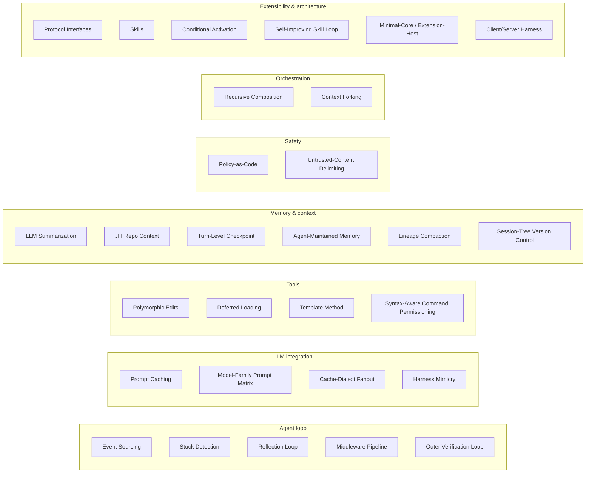
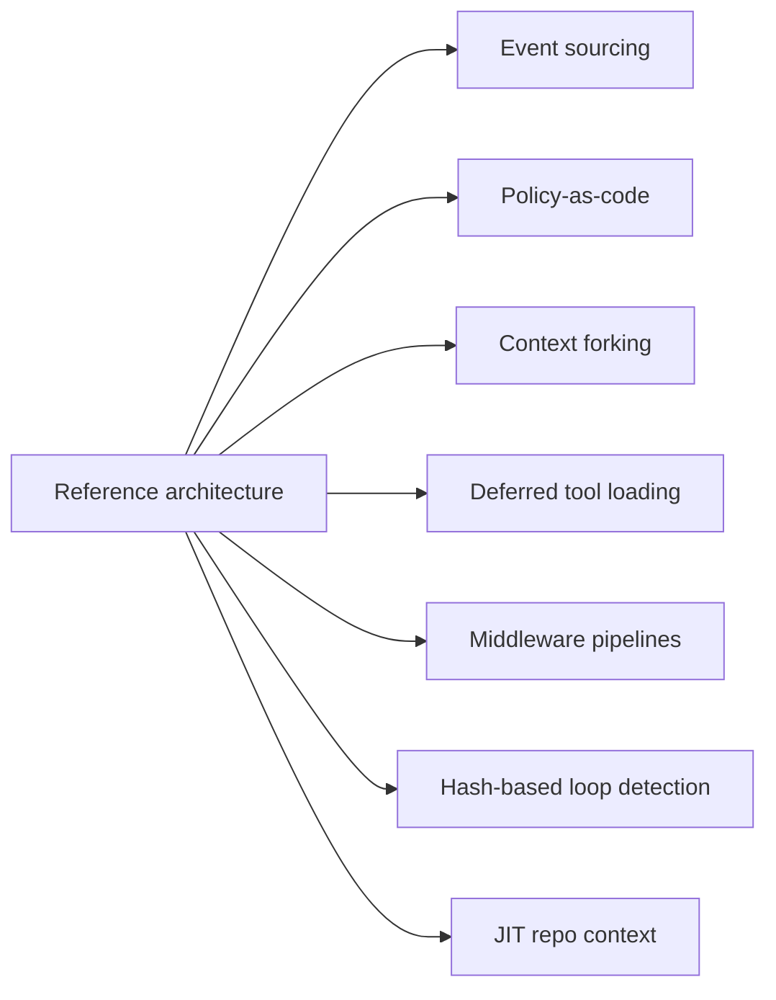

# The 29 recurring design patterns: Harness Engineering (arXiv:2609.00006)

← Back to the [main note](README.md). Source: paper §13.1, Tables 11–12. Pattern membership is as of the July 2026 pins.

## Map: patterns by subsystem

## Part 1: the 17 April-edition patterns (membership updated to July)

| # | Pattern | What it is | Used by |
|---|---|---|---|
| 1 | **Event Sourcing** | Actions and observations appended to a persistent event log | OpenHands; Pi (session log as a tree); OpenCode (log-as-queue, v2 tables) |
| 2 | **Policy-as-Code** | Safety rules expressed as executable config | Codex (Starlark with inline validated examples), Claude Code (hooks), Gemini CLI (TOML modes), Hermes (config-as-policy + hardline floor), OpenCode (rulesets), Pi (extension hooks) |
| 3 | **Recursive Composition** | Agents spawn sub-agents with forked or linked context | Claude Code, Codex, OpenHands, OpenClaw; config-gated in Hermes; opt-in in OpenCode |
| 4 | **Polymorphic Edits** | Edit format or toolset chosen per model | Aider (prompt factory), OpenCode (tool registry) |
| 5 | **Deferred Loading** | Tools or skills hidden from the prompt and discovered on demand | Claude Code, Codex (BM25 `tool_search`), Hermes (BM25 bridge tools), plus 8 skills implementations |
| 6 | **Template Method** | A base class defines the flow; subclasses override parse/format | Aider (`Coder`), OpenHands (`Agent`) |
| 7 | **Protocol Interfaces** | Structural subtyping, or interface seams for pluggable parts | Mini-SWE-Agent, Pi (per-tool Operations remoting seam) |
| 8 | **LLM Summarization** | An LLM compresses conversation history | 9 systems (all except Mini-SWE-Agent; Aider partially) |
| 9 | **Stuck Detection** | Automatic detection of repetitive behavior | OpenHands (5 scenarios), Gemini CLI (hash + LLM hybrid), Hermes (signatures, warns first), OpenCode (doom-loop ask), Mini-SWE-Agent (format-error cap) |
| 10 | **Reflection Loop** | An inner self-correction cycle driven by lint/test feedback | Aider; cousins: Gemini CLI (edit fixer), OpenCode (LSP feedback) |
| 11 | **Prompt Caching** | Prompt structured around a cache boundary, or a reused session key | Claude Code, Codex, OpenHands (cache tiers), Hermes (prefix normalization), Pi (breakpoints + TTL), OpenCode (dialect fanout) |
| 12 | **Context Forking** | Parent state cloned to isolate a sub-agent | Claude Code, Codex, Hermes (cache-sharing background fork) |
| 13 | **Middleware Pipeline** | Composable turn-level policies kept separate from the loop body | Mistral Vibe |
| 14 | **JIT Repo Context** | Hierarchical Markdown context files, auto-discovered and injected on demand | Claude Code, Codex, Gemini CLI, Mistral Vibe, Hermes, Pi, OpenCode, OpenHands |
| 15 | **Skills** (capability bundles) | `SKILL.md` directories with YAML frontmatter | 9 systems (all except Aider and Mini-SWE-Agent) |
| 16 | **Conditional Activation** | Skills or tools gated by environment or file paths | Claude Code (`paths`), OpenHands (`PathTrigger`), OpenClaw (`requires`) |
| 17 | **Turn-Level Checkpoint** | Filesystem snapshots with rewind and file restore | Mistral Vibe (per user message), OpenCode (shadow git, per step), Hermes (shadow-git store), Pi (conversation only) |

## Part 2: the 12 patterns new in the July corpus

| # | Pattern | What it is | Used by |
|---|---|---|---|
| 18 | **Agent-Maintained Memory** | A background sub-agent extracts and consolidates memory across sessions | Codex (two-phase, git-baselined); human-gated variant in Gemini CLI (patch inbox) |
| 19 | **Outer Verification Loop** | A scaffold-level judge or guard checks completion, outside the turn loop | OpenHands (`/goal` judge + critics), Hermes (verify-on-stop) |
| 20 | **Self-Improving Skill Loop** | The agent writes, patches and curates its own skills | Hermes; partially Gemini CLI (skill-extraction inbox) |
| 21 | **Lineage Compaction** | Compaction rotates to a new session and keeps a searchable ancestry chain | Hermes |
| 22 | **Session-Tree Version Control** | Append-only entry tree with a movable head; fork, rewind and branch summaries | Pi; OpenHands (conversation tree) |
| 23 | **Minimal-Core / Extension-Host** | Safety, sandbox, sub-agents and plan mode moved out to a runtime event bus | Pi |
| 24 | **Client/Server Harness** | An embedded API server; every UI (TUI, web, IDE, CI) is a client | OpenCode; OpenHands (agent-server) |
| 25 | **Model-Family Prompt Matrix** | Separate base prompts per model family or generation | Codex (server catalog), OpenCode (9 prompts), Hermes (gated blocks) |
| 26 | **Cache-Dialect Fanout** | Every provider's cache-control dialect emitted at once | OpenCode |
| 27 | **Syntax-Aware Command Permissioning** | Commands parsed with tree-sitter; grants scoped by argument count | OpenCode; Mistral Vibe (parse validation), Hermes (deobfuscated matching) |
| 28 | **Untrusted-Content Delimiting** | Tool and web results wrapped in taint markers, with delimiter lookalikes defanged | Hermes, OpenHands (`<UNTRUSTED_CONTENT>`) |
| 29 | **Harness Mimicry** | A client presents a first-party harness's identity (headers, prompt opening, tool-name casing) to use its subscription OAuth backend | Pi (Claude Code identity on Anthropic OAuth; ChatGPT-plan Codex backend) |

## Patterns the paper says are documented for the first time

These come from the §1 contributions list:

- Agent-maintained memory pipelines
- Verify-on-stop guards
- Lineage compaction
- Session-tree version control
- Log-as-queue loops
- Syntax-aware command permissioning
- Cache-dialect fanout
- Harness mimicry

## Pattern diffusion, April → July

From §14.5: competitive distinctives currently have a **half-life measured in weeks**.

| Pattern | April | July |
|---|---|---|
| Deferred tool loading | 1 system | 3 (plus 7 skills variants) |
| Read-only plan mode | 2 | All 4 provider-native systems |
| LLM approval classifier | 1 (Claude Code) | 2 (+ Codex Guardian) |
| Turn-level checkpointing | 1 (Mistral Vibe) | 3 |
| Safety-aware scheduler partitioning | 1 | 2 |
| User-facing lifecycle hooks | Claude Code distinctive | 9 of 11 |

## Reference-architecture candidates

From §17.2 future work: the patterns the authors propose formalizing into a reference spec.

