# Subsystem deep dive: Harness Engineering (arXiv:2609.00006)

← Back to the [main note](README.md). This page gives one section per subsystem (paper §6–12), each with a diagram, a comparison table, and the observation it supports. All numbers come from the paper's July 2026 pins; Claude Code figures come from the March 2026 snapshot.

**Contents:** [0 System overview](#0-system-overview-5) · [1 Loop](#1-agent-loop-6) · [2 LLM integration](#2-llm-integration--prompts-7) · [3 Tools & editing](#3-tools-editing-sandboxing-8) · [4 Memory & context](#4-memory--context-9) · [5 Safety](#5-safety--permissions-10) · [6 Multi-agent](#6-multi-agent-orchestration-11) · [7 Extensibility](#7-extensibility-12) · [Claude Code vs Codex](#claude-code-vs-codex-the-full-pipeline)

---

## 0. System overview (§5)

### Table 4 (full)

| System | Lang | Scale | Provider | Tools | Multi-agent | Sandbox | UI | Signature capability |
|---|---|---|---|---|---|---|---|---|
| OpenHands | Python | Medium | Multi | 25+ | Yes | Docker / Apptainer / remote | Web + CLI + SDK | Resource-locked parallel tools; hosts rival harnesses as ACP backends |
| Aider | Python | Small | Multi | 13 edit formats | No | None | CLI | 13 polymorphic edit formats; the only ranked repo map |
| Claude Code | TS | Large | Anthropic | 43 | Yes | Opt-in runtime + worktree | CLI | Deferred tool loading; prompt-cache-sharing forks; "the reference others copy" |
| Codex | Rust | Very large | OpenAI | 25–30 | Yes | Native, 3 OSes | CLI/TUI | Agent-maintained cross-session memory; tool calls as V8-executed code |
| Gemini CLI | TS | Very large | Google | 35+ | Yes | Native, 3 OSes | CLI/TUI | Model routing as runtime scheduling; the only A2A server |
| Mistral Vibe | Python | Small | Mistral + generic | 12+ | Yes | Worktree opt. | CLI/TUI | Middleware-pipeline loop; rewind exposed over ACP |
| Mini-SWE-Agent | Python | Tiny | Multi | 1 | No | Docker+ | CLI | 100-line floor: all 7 subsystems, minimally |
| Hermes | Python | Very large | Multi (owned transports) | 69 | Yes | 6 pluggable backends | CLI/TUI/Web + 28 channels | Self-improving skill loop; lineage compaction; verify-on-stop |
| Pi | TS | Medium | Multi (35 providers) | 7 | Extension | None (by design) | CLI/TUI | Everything-is-an-extension core; session-tree version control |
| OpenCode | TS | Large | Multi | 17 | Yes | None (policy) | Client/server | Client/server harness; syntax-aware command permissioning |
| OpenClaw | TS | Large | Multi | 109+ | Yes | None | Multi-channel | Gateway delegation; Active-Memory sub-agent before each reply |

**Scale bands:**

| Band | Approx. lines |
|---|---|
| Tiny | under 5K |
| Small | 20–40K |
| Medium | 80–110K |
| Large | 500K+ |
| Very large | 600K+ |

Named sizes: Codex about 1.1M lines of Rust, Hermes about 642K, OpenCode about 578K. The paper says these are order-of-magnitude figures and not comparable across languages.

**Benchmarks** (footnote 4) were removed from the table because they are self-reported, use different model generations, and some predate current defaults. Spring-2026 self-reported scores on SWE-bench Verified:

| System | Score |
|---|---|
| OpenHands | 77.6% |
| Mini-SWE-Agent | 74%+ |
| Claude Code | 72.7% |
| Codex | 69.1% |

The other systems publish no comparable number. Pi explicitly asks for real-world session data "instead of toy benchmarks".

> **Obs. 1:** The 11 systems span 3 orders of magnitude in size on similar tasks, yet loop sophistication does not predict benchmark score. Most production mass goes to safety, UX, extensibility and, increasingly, clients and transport. About 3/5 of OpenCode's non-test source is TUI, web, desktop and SDK clients. Codex devotes six-figure line counts to app-server transports, plugins and realtime voice.

---

## 1. Agent loop (§6)

All 11 systems implement ReAct. The paper groups them into three paradigms:

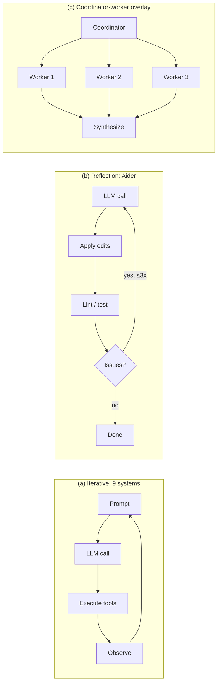

| System | Loop type | Concurrency | Stuck detection | Stop |
|---|---|---|---|---|
| Mini-SWE-Agent | Linear `while` | Sequential | Format-error cap, wall clock | Exit message |
| Aider | Generator + reflection | Sequential | Max 3 reflections | Stream end |
| Claude Code | Streaming + batches | Safety-partitioned (max 10) | None | `end_turn` |
| Codex | Tokio async state machine | `FuturesOrdered` | None | `end_turn` |
| Gemini CLI | Async generator + scheduler | Parallel; edits sequential; model sees `wait_for_previous` | SHA-256 (5 identical calls) + LLM check after 30 turns | `end_turn` / 100 turns |
| Mistral Vibe | Async + middleware stack | `asyncio.create_task` | Turn/price/token middleware | `end_turn` |
| OpenHands | Event-sourced conversation | Resource-locked batches | 5 scenarios | `FINISHED` |
| Hermes | Budgeted `while` + stop guards | 8 workers, safety-gated | Signature hash; warns first, hard stop off | 90-iteration budget; verify-on-stop veto |
| Pi | Functional core + steer/followUp queues | `Promise.all` + per-file queue | None (by design) | `end_turn`, no cap |
| OpenCode | **Log-as-queue** `while(true)` | Uncapped parallel | 3 identical calls → permission ask | No tool calls |

**Notable mechanisms**
- **Claude Code:** `partitionToolCalls()` groups consecutive `isConcurrencySafe` tools (reads) into batches; writes run alone. Safety is opt-in per tool.
- **Mistral Vibe** middlewares: `TurnLimit`, `PriceLimit`, `TokenLimit`, `AutoCompact`, `ContextWarning`, `ReadOnlyAgent`. Policies are layered on top of the loop instead of being branches inside it.
- **OpenCode:** pending spawns and compactions are persisted as message parts, so the loop is **resumable across restarts**.
- **Hermes verify-on-stop:** if code files were changed and there is no fresh verification evidence, a "done" text reply is rewritten into a continuation.
- **Pi truncation-poisoning guard:** if the assistant message was cut off at the length limit, every tool call in it fails without running.
- **Outer loops** ("loop engineering") wrap the inner ReAct cycle: OpenHands `/goal` with an LLM judge, Hermes verify-on-stop.

**More per-system detail (§6.2–6.4)**
- **OpenHands:**
  - `LocalConversation` drives `Agent.step()`. Every event is appended to a persistent `EventLog`: one file per event via `FileStore`, flock-protected, with `SecretRegistry` redaction.
  - History is a cached projection of the active branch. State is a tree with a movable head, so replay, fork and branch are first-class.
  - `ParallelToolExecutor` uses resource locks keyed on declared resources (files, terminal, browser). The concurrency limit defaults to 1.
  - `StuckDetector` checks 5 scenarios: repeating action-observation pairs, repeating actions with errors, monologue, alternating patterns, and context-window error loops.
- **Codex:**
  - Tokio state machine. `Session` runs turns over `ResponseItem` events (SSE or WebSocket).
  - Entry points: `Codex::spawn()`, `submit_with_id()`, `next_event()`.
  - `codex.rs` has been split into `session/` modules plus `CodexThread`.
- **Gemini CLI:**
  - Async generator yielding `ServerGeminiStreamEvent`.
  - The `Scheduler` state machine runs Validating → Executing → Completed/Errored.
  - Loop detection aborts on 5 identical tool calls or 10 identical content chunks (SHA-256). An LLM self-check starts after 30 turns, at an adaptive interval.
  - 11 lifecycle hook events. Since v0.45 the scheduler partitions by concurrency safety.
- **Mistral Vibe:**
  - 6 profiles: default, plan, accept-edits, auto-approve, explore, lean. A 7th, `chat`, is registered by the ACP layer only.
  - Plan mode is structural: the plan file is the only writable target, and `exit_plan_mode` emits `PlanReviewRequestedEvent`.
- **Hermes:**
  - `IterationBudget` defaults to 90; `execute_code` iterations are refunded, and a final grace call summarizes.
  - 11 enumerated exit reasons.
  - Stuck detection warns after 2 identical failures and would halt at 8, but the hard stop ships disabled.
  - Mid-turn steering is spliced into the last tool result behind an anti-injection marker.
- **Pi:**
  - The functional core is 790 lines, with documented refusals: no planner, reflection, turn cap, stuck detection or cost kill-switch.
  - `steer()` injects after the current tools finish. `followUp()` drains only when the agent would otherwise stop.
  - Retries use an allowlist of 40 transient-error patterns, plus a one-shot compact-and-retry on overflow.
- **OpenCode:**
  - `maxSteps` defaults to infinity. When a configured cap is hit, it appends a message saying tools are disabled.
  - Retry uses exponential backoff that respects retry-after. Overflow switches to compaction and is never retried.
- **Aider:**
  - `run_one()` applies edits, then runs a 3-stage Python lint (syntax → compile → flake8), checks tests and unresolved file mentions, and calls `reflected_message` again (default max 3).
  - `TreeContext` (grep_ast) shows code around errors.
  - There is no tool-call loop, and it never inspects `end_turn`.
  - Related work: Reflexion, Self-Refine, CRITIC, Self-Debug.
- **Coordinator overlays:**
  - Claude Code `AgentTool`: phases Research → Synthesis → Implementation → Verification.
  - Codex `AgentControl::spawn_agent()`: dedicated `ThreadId`s and typed mailboxes.
  - Hermes: orchestrator role plus spawn depth; Kanban swarm.
- **Loop composition:** following Rombaut, production loops *compose* primitives (ReAct, generate-test-repair, plan-execute, retry). The plan modes in all 4 vendor systems are plan-execute grafted onto ReAct.
- **Loop engineering (Jun 2026):** Steinberger: "design loops that prompt your agents". Osmani gives the anatomy: triggers, topology, verifiers, stop rules. Harness engineering is the *inner* action-observation cycle; loop engineering composes the *outer* loops around it.

> **Obs. 1:** Loop sophistication does not predict benchmark score. Production code mass goes to safety, UX, extensibility and clients; about 3/5 of OpenCode's non-test source is clients.

---

## 2. LLM integration & prompts (§7)

### Provider abstraction spectrum

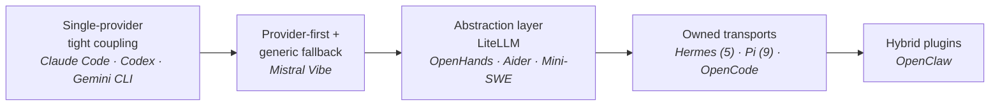

> **Obs. 2:** Caching, thinking and per-model prompts are reachable from *any* point on this spectrum if you pay the per-provider code cost (Hermes, Pi, OpenCode do). What tight coupling still buys is the **update loop**: Codex re-tunes prompts, reasoning tiers and multi-agent tools per model release from a server catalog, with no client release.

### Prompt assembly: the cache boundary idea (Claude Code)

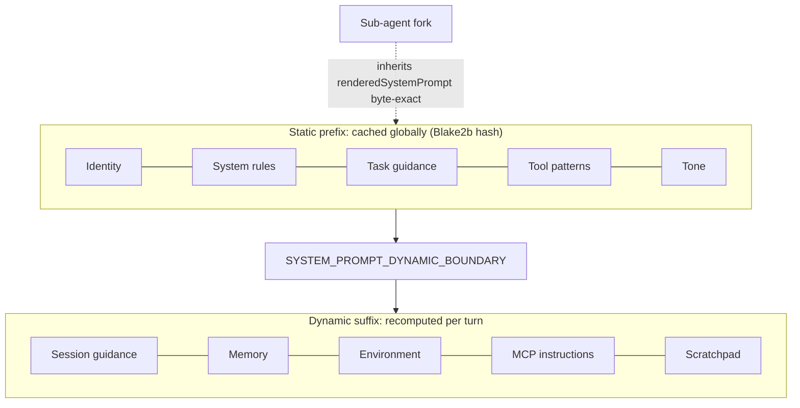

| System | Prompt architecture | Caching |
|---|---|---|
| Claude Code | 12–15 modular sections + boundary | Blake2b static prefix |
| Codex | Per-model prompts **delivered as server data** (`models.json`, GPT-5.2 → 5.6) | `thread_id` cache key |
| Gemini CLI | Capability-gated snippets (modern/legacy) + 3-scope GEMINI.md | None at request level |
| Mistral Vibe | Per-agent Markdown + server-side A/B variants | Git status cached |
| OpenHands | `PromptRegistry`, 18 static sections + dynamic block | STATIC/DYNAMIC tiers |
| Hermes | 3 tiers (stable/context/volatile), model-family-gated blocks | Bit-perfect prefix normalization |
| Pi | One 170-line builder | Breakpoints + TTL + dollar-waste audit |
| OpenCode | 9 base prompts by model family | **6 cache dialects emitted at once** |
| Aider | Polymorphic `CoderPrompts` per edit format | Anthropic markers |
| Mini-SWE | One-shot Jinja2 | Anthropic markers |

### Prompt rhetoric (§7.3)

| Theme | What the prompts say |
|---|---|
| Verbosity | 9/11 have explicit rules. OpenCode: "fewer than 4 lines". Mistral Vibe: "under 150 words". |
| Banned phrases | Mistral Vibe bans "robust", "seamless", "Great!", "Happy to help!" and all emoji. OpenCode's GPT prompt bans "Got it" and em dashes. |
| Anti-gold-plating | Present in 6 scaffolds ("Don't add features… beyond what was asked"). Codex 5.6 dropped it. |
| Read-before-edit | Claude Code and Mistral Vibe state it. OpenCode claims it in the prompt but does not enforce it. Hermes mechanizes verification. |
| Commits | Universal "no commit" in April, split three ways by July. Nobody allows autonomous push or force-push. |
| Emphasis | Three schools: rhetorical (IMPORTANT/NEVER), structural (precedence contracts), example-driven. |
| Refusals | **0/11** prompts contain policy-level harmful-request refusal language; safety is left to the model. |

> **Obs. 3:** Rhetoric converges where experience converges, then thins as trust calibrates, and behavior policy moves from prose into config and feature flags.

**Provider details (§7.1)**
- **Gemini `ModelRouterService`** chains pluggable strategies:
  1. fallback
  2. override
  3. approval-mode
  4. 3 classifier strategies (one can run locally on Gemma via LiteRT-LM)
  5. default

  Defaults are now gemini-3(.1)-pro-preview and gemini-3.1-flash-lite. Gemma 4 can be routed to. The 2.5 family remains only as a no-preview fallback.
- **Mistral Vibe** factory: `MistralBackend` (official SDK) or `GenericBackend` (Anthropic, Vertex, OpenAI-compatible, OpenAI Responses). A 5-level thinking field maps to `reasoning_effort`.
- **LiteLLM systems:** 100+ models. Aider's registry holds 350+ models (edit format, weak model, cache control). OpenHands adds `LLMRegistry`, `LLMProfileStore`, `RouterLLM` and fallback.
- **Owned transports:**
  - **Hermes:** 5 transports (chat-completions, Anthropic Messages, Bedrock Converse, Codex Responses, Codex app-server), 29 `ProviderProfile` plugins, 3,800+ models from models.dev.
  - **Pi:** 9 wire protocols, 35 providers, 20 per-model quirk flags, 10 `thinkingFormat` dialects.
  - **OpenCode:** a 1,400-line per-vendor transform matrix with reasoning tiers gated by release date. It can install providers at runtime.
- **OpenClaw:** 10+ provider adapters, auth-profile rotation, last-good tracking, cooldowns.

**Codex prompt openings by generation**

| Model | Opening line | Rules |
|---|---|---|
| GPT-5.2 | "You are GPT-5.2 running in the Codex CLI…" | Has the no-commit and anti-gold-plating rules |
| GPT-5.5 | "You are Codex, a coding agent based on GPT-5…" | Drops them |
| GPT-5.6 | "You are Codex, an agent based on GPT-5" | Drops them |

The `{{ personality }}` variable is friendly or pragmatic. Prompts are refreshed from remote `/models` with an ETag. *The paper is inconsistent about the `codex_git_commit` flag: §7.2 says it "now governs" commits, §7.3 says it is retired.*

**Persona openings (§7.3)**

| System | Persona |
|---|---|
| Mini-SWE | "You are a helpful assistant that can interact with a computer" |
| Pi | "expert coding assistant operating inside pi" |
| OpenHands | `<SOUL>` block from a user-overridable SOUL.md |
| OpenCode (Claude prompt) | "You are OpenCode, the best coding agent on the planet." |
| Hermes | "Operate like a careful senior engineer" (auto-detected coding posture) |
| Aider | "Act as an expert software developer." |
| Mistral Vibe | April: "CRITICAL: Users complain you are too verbose". July: a 7-level instruction-precedence contract |

**Other rhetoric details**
- **Claude Code** has quantified word budgets, but only in Anthropic-internal A/B builds; external users get qualitative guidance. It also forbids false success claims ("Never claim 'all tests pass'…").
- **Mistral Vibe:** "Never edit a file you have not read in this session. Do not edit in the same turn you first read it."
- **Codex 5.2** bans `[F:README.md L5-L14]` citation glyphs, because the terminal can't render them.
- **Tool philosophy:**
  - Claude Code: "Do NOT use the Bash tool…" (use dedicated tools).
  - Codex: "Parallelize tool calls whenever possible".
  - Mini-SWE: exactly one bash block per turn, with `cd` inside each command because every call runs in a new subshell.

### Table 16: prompt rhetoric at a glance

| System | Verbosity | Anti-gold-plating | Commit policy | Emoji | Emphasis |
|---|---|---|---|---|---|
| Claude Code | Quantified (internal A/B) | Explicit | No commit unless asked | Conditional | IMPORTANT / NEVER |
| Codex | Qualitative (5.2) → persona-driven (5.6) | Explicit (5.2) → dropped (5.6) | No commit (5.2) → feature flag (5.6) | None | NEVER tags |
| Gemini CLI | Via snippet gating | Implicit | Implicit | None | Feature-gated sections |
| Mistral Vibe | Strict word limit | Explicit | **Reversed**: commits expected, with signature trailer | Strict ban | Structural precedence contract |
| OpenHands | None | Explicit (no file-suffix copies) | Commits taught; push/PR gated | None | XML role tags |
| Aider | "Few short sentences" | Implicit | Silent | Silent | Format examples |
| Mini-SWE | Structural (1 command per turn) | Silent | Silent | Silent | `<important>` XML |
| Hermes | "Lead with the change" | Explicit | No commit/push/rewrite unless asked | None | MUST/NEVER + exemplar pairs; model-gated XML |
| Pi | "Be concise" | Delegated | Delegated | Silent | XML data tags only |
| OpenCode | Quantified (<4 lines; model-dependent) | Explicit | No commit unless asked | Conditional; banned in the GPT prompt | IMPORTANT/NEVER + system-reminder |
| OpenClaw | Per agent | Inherited | Inherited | Inherited | Per agent |

### Streaming (§7.4)

| System | Streaming and response handling |
|---|---|
| Claude Code | SSE; thinking blocks with `budget_tokens` |
| Codex | WebSocket primary, SSE fallback; connection prewarm (`generate=false`); `x-codex-turn-state` header |
| Gemini CLI | `sendMessageStream()`; 4-attempt mid-stream retry; custom `GeminiChat` wrapper; thinking kept out of history |
| Mistral Vibe | `stream_async()` aggregates `LLMChunk`; `ThinkChunk` → `reasoning_content` |
| Aider | mdstream token streaming; backoff; on `FinishReasonLength`, resumes with an assistant prefill |
| Mini-SWE | No streaming |
| OpenHands | SSE via LiteLLM; `LLM.stream`, `on_token`; Responses path |
| Hermes | 5 transports; `FailoverReason` enum with 23 values (compress / rotate credential / fall back / abort) |
| Pi | 9 protocols; salvage parser for partial JSON + truncation guard |
| OpenCode | Vercel AI SDK `streamText`; part deltas persisted and re-served over SSE to all clients |
| OpenClaw | ACP delta events (text, thought, tool calls) |

### Table 17: advanced API features

| System | Prompt caching | Ext. thinking | Reasoning effort | Model routing | WebSocket | Vision | Cost tracking |
|---|---|---|---|---|---|---|---|
| OpenHands | Partial (tiers + markers) | ✓ | ✓ | ✓ RouterLLM | ✗ | ✓ | Per model |
| Aider | Partial | ✗ | ✗ | ✗ | ✗ | Opt. | Tokens + $ |
| Claude Code | **Full** (Blake2b boundary) | ✓ | ✗ | ✗ | ✗ | ✓ | Tokens + $ |
| Codex | Partial (`thread_id` key) | ✗ (as printed) | ✓ up to max/ultra | ✗ | ✓ | ✓ | Per turn |
| Gemini CLI | ✗ (server-side) | ✓ | ✗ | ✓ router | ✗ | ✓ | OTel, tokens + $ |
| Mistral Vibe | Partial | ✓ | ✓ (5 levels) | ✗ | ✗ | ✓ | OTel, per session |
| Mini-SWE | Partial | ✗ | ✗ | ✗ | ✗ | Opt. | litellm |
| Hermes | **Full** (agnostic markers + prefix normalization) | ✓ | ✓ (5, translated per provider) | Failover chains only | ✗ | ✓ | Tokens + $, typed provenance |
| Pi | **Full** (breakpoints + TTL + waste audit) | ✓ (7-level scale) | ✓ (10 dialects) | ✗ by design | ✓ (Codex backend) | ✓ | Tokens + $, tiered |
| OpenCode | **Full** (6-dialect fanout + session key) | ✓ | ✓ (date-gated) | Small-model selection only | Experimental flag | ✓ | Tokens + $ (Decimal) |
| OpenClaw | Partial | ✓ | ✗ | ✗ | ✓ | ✓ | Per provider |

*The table was reconstructed from a flattened layout, so cell alignment for the Pi, OpenCode and OpenClaw rows may be slightly off.*

**Notes:**
- **Codex reasoning effort** runs minimal → low → medium → high → xhigh, plus max and **ultra**. Ultra means max reasoning plus automatic sub-agent delegation; no other system has it.
- **No corpus system is unconditionally text-only.**
- **Observability:** Gemini and Vibe export OTel traces. Pi audits dollars wasted on cache misses each turn.

---

## 3. Tools, editing, sandboxing (§8)

### Tool count spectrum

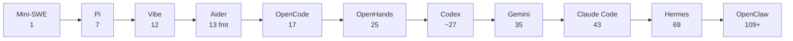

### Deferred tool loading

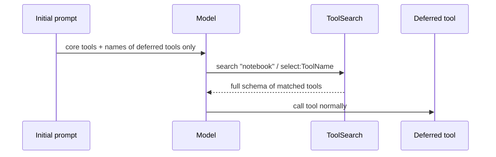

- **Claude Code:** `shouldDefer` + `ToolSearchTool`, about 40% fewer prompt tokens.
- **Codex:** `defer_loading` + **BM25** `tool_search`.
- **Hermes:** once MCP schemas exceed **10% of context**, collapses them into 3 bridge tools (`tool_search` / `tool_describe` / `tool_call`).

### File editing strategies

| System | Format | Matching | Fallback |
|---|---|---|---|
| Claude Code | Exact string replace | Unique substring | Error + context |
| Mistral Vibe | Exact (moved off fuzzy, Apr→Jul) | Unique substring | Ambiguity error |
| Pi | Multi-edit exact | + Unicode/whitespace canonicalization | Uniqueness error |
| Codex | `*** Begin Patch` DSL | Diff hunks | Hunk retry; Lark-grammar variant |
| Gemini CLI | old/new edit | Exact → flexible → regex → fuzzy | **LLM edit-fixer subcall** |
| OpenCode | Patch DSL for GPT, edit for others | 9-stage cascade (Levenshtein 0.65) | Distinct not-found vs ambiguous errors |
| Hermes | SEARCH/REPLACE + V4A | 9-strategy chain ("inspired by OpenCode") | Escalates to `write_file` after 3 failures |
| Aider | 13 formats | Exact → fuzzy (dmp) | Similar-line hints; RelativeIndenter |
| Mini-SWE | sed/awk via bash | Regex | Shell error |

**Tool interface architectures (§8.2)**

| System | Interface |
|---|---|
| Mini-SWE | A single shell call (`Popen(shell=True)`); kills the process group on timeout |
| Claude Code | Each tool declares validation, permission, concurrency safety and UI rendering separately |
| Codex | Rust trait objects `Arc<dyn CoreToolRuntime>`, in a `codex-tools` crate |
| Gemini CLI | State-machine `Scheduler` |
| Mistral Vibe | `tree_sitter_bash` validation; permission scopes for command pattern, file pattern, URL allowlist and directory containment |
| Hermes | Singleton registry: tools self-register at import; toolsets scoped per platform; availability probes (30 s TTL); a coercion layer repairs schema drift ("42" → 42) |
| Pi | A pluggable Operations interface per tool (`BashOperations`, `EditOperations`) is the remoting seam for SSH, containers or micro-VMs |
| OpenCode | 17 tools with Effect schemas; the surface is swapped per model (GPT gets `apply_patch` and loses edit/write) |

**More on deferred loading:**
- **OpenCode** defers skills only. Its experimental "code mode" is a single `execute` tool that runs model-written scripts against the MCP catalog.
- **Mistral Vibe** `defer_mcp` defers only the MCP *connection*, not prompt visibility, so the paper doesn't count it as deferred loading.

**Editing details:**
- **OpenCode** cascade: exact → line-trimmed → block-anchor → whitespace / indentation / escape-normalized → context-aware, with a guard against disproportionate matches. It credits Cline and Gemini CLI evals.
- **Aider** `RelativeIndenter` converts to relative indentation with a Unicode marker, plus `diff_match_patch` (threshold 0.95, distance 500).
- **Pi** applies NFKC, normalizes smart quotes and trailing whitespace, overlays the result line by line onto the original bytes, and previews the diff.
- **Mistral Vibe's** old 0.90 fuzzy matcher only ever produced diagnostics, never fuzzy edits. The April edition was wrong about this.
- **Recommendation 5:** never edit by line number, because models drift on line numbers more than on context.

> **Obs. 4:** The edit strategy is a top accuracy lever. Frontier-model harnesses converge on **exact matching**; multi-model harnesses keep **fuzzy cascades**. Lineage is visible in code comments.

### Sandboxing

| Tier | Systems | Mechanism |
|---|---|---|
| Native, 3 OSes | Codex, Gemini CLI | Bubblewrap (vendored in Codex) / Seatbelt / restricted tokens |
| Opt-in OS | Claude Code | Anthropic sandbox-runtime + git worktrees |
| Container backends | OpenHands, Mini-SWE, Hermes (6 backends) | Docker / Apptainer / remote |
| Policy only | OpenCode, Mistral Vibe (worktree opt.) | Permission rules |
| None | Pi (documented), Aider, OpenClaw | — |

**Sandbox mechanics:**
- **Codex on Linux:** vendored Bubblewrap via C FFI (`--ro-bind / /`, `--bind` writable roots, `--unshare-net`, user and PID namespaces), with a Landlock legacy fallback. Inside writable roots, `.git`, `.agents` and `.codex` are re-marked read-only.
- **Codex on macOS and Windows:** `/usr/bin/sandbox-exec` on macOS; restricted tokens with ACLs on Windows.
- **Gemini CLI:**
  - `SandboxManager` supports Docker, Bubblewrap, gVisor or LXC on Linux.
  - Per-mode TOML policy.
  - Env scrubbing: name regexes for TOKEN, SECRET, KEY, AUTH and CREDENTIAL, a denylist, and GitHub-token value regexes.
  - Cheaper to build because it reuses Node child processes and OS binaries.
- **Hermes** has 6 backends: local, Docker, SSH, Singularity, Modal, Daytona. The local backend is a policy floor only.

> **Obs. 6:** An OS sandbox is a deliberate choice. Hermes (642K lines) and OpenCode (578K) have none and spend on content-borne threat defense and permission granularity instead.

---

## 4. Memory & context (§9)

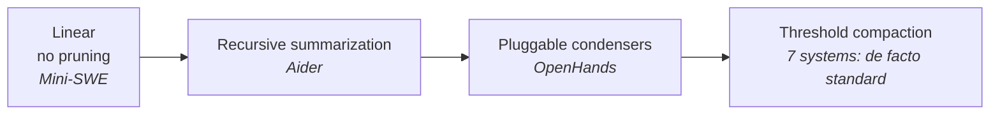

| System | Trigger | Keeps verbatim | Twist |
|---|---|---|---|
| Claude Code | 13K tokens below window | — | Restores 5 files (50K budget) after compaction |
| Gemini CLI | 50% of limit | Last 30% | Context graph, per-file FULL/PARTIAL/SUMMARY/EXCLUDED |
| Pi | window − 16K | ~20K recent | Iterative summary merge; session tree |
| OpenCode | input limit − output reserve | 2 user turns | Merges `<previous-summary>` into fixed sections |
| Hermes | 50% − max tokens (64K floor) | First 3 + tail | **Lineage compaction**: rotates to a child session, keeps history |
| Mistral Vibe | threshold, pre-turn middleware | Prior user msgs re-injected | Also fires reactively on overflow |
| Codex | `model_auto_compact_token_limit` | — | Local or cloud `/responses/compact` |

### Persistent memory: the new frontier

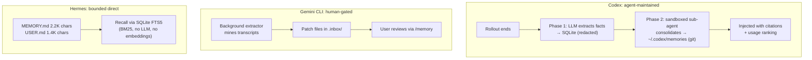

> **Obs. 5:** Compaction has converged. The memory **write path** and its governance are where systems now differ: agent-maintained, human-gated, bounded direct, or pre-turn recall (OpenClaw). None uses embeddings as its primary memory store.

**Other compaction mechanisms:**
- **Mini-SWE:** an unbounded list, up to 1M tokens with Claude 4. Good for reproducibility.
- **Aider `ChatSummary`:** when history exceeds `max_tokens` (1024), it keeps the newer 50% and summarizes the older half, recursing up to 3 levels. It can use an optional weak model.
- **OpenHands condensers:** V0 had 10; the V1 SDK has 3 (`NoOp`, `LLMSummarizing`, `Pipeline`) over a `RollingCondenser` base. Event-sourced `CondensationRequest` events double as overflow recovery. Triggers by token count or event count.
- **Claude Code steps:**
  1. Strip images to `[image]`.
  2. Group messages by API round.
  3. Run the LLM summary.
  4. Insert a `SystemCompactBoundaryMessage`.
  5. Restore up to 5 files (50K budget) and truncate skills to 25K tokens each.
- **Codex:** `/memories/trace_summarize` serves the memory pipeline. Remote compaction v2 and per-thread rollout token budgets with turn aborts.
- **Gemini context processors:** rolling summary, node distillation, node truncation, blob degradation, tool masking, state snapshot. The `ContextManager` keeps a pristine vs active graph, with hysteresis to damp triggers.
- **Mistral Vibe `RewindManager`:** a filesystem checkpoint per user message, forkable and exposed over ACP.
- **OpenCode:** shadow-git checkpoints at pre-stream, step start and step finish allow a full conversation-plus-filesystem revert. Opt-in pruning soft-deletes old tool outputs; it protects the newest 40K and runs only if more than 20K is reclaimable. Token counts use a chars/4 estimate with no tokenizer.
- **Pi:** the session is an append-only JSONL tree (`id`/`parentId`). `/tree`, `/fork` and `/clone` unify checkpoint, rewind and alternatives. Branch summaries are written by the LLM when a branch is abandoned. Filesystem state is *not* restored.

**Other memory systems:**
- **Claude Code:** per-project memory directories of Markdown facts (`memdir`).
- **OpenHands:** a `<MEMORY>` prompt section tells the model to write durable facts into AGENTS.md.
- **OpenClaw:** an Active Memory plugin runs a sub-agent before each reply. An older LanceDB extension is opt-in.
- **Codex:** an experimental "chronicle" sidecar captures passive screen context.
- **Pi and Mini-SWE:** nothing beyond the session.

### Repo context (§9.7)

| System | How project context is found |
|---|---|
| Aider | **The only ranked repo map**: tree-sitter symbols, diskcache, ranked by relevance to the conversation, `map_tokens` = 1024 |
| Claude Code | `claudemd` subsystem (managed / user / project scopes, nested attachments with dedup) + `memdir` |
| Codex | AGENTS.md concatenated root → cwd (nested last), `AGENTS.override.md`, configurable root markers |
| Gemini CLI | 3-scope GEMINI.md gated by folder trust; JIT subdirectory context via tool output; MEMORY.md index |
| Mistral Vibe | Top-level AGENTS.md; nested AGENTS.md attached JIT when `read_file` touches a subtree |
| Hermes | First found wins: .hermes.md → AGENTS.md → CLAUDE.md → .cursorrules. **Every file is scanned for prompt injection and blocked wholesale on a match** |
| Pi | Ancestor walk for AGENTS.md / CLAUDE.md → `<project_context>`. Context files load even when the repo is untrusted (documented) |
| OpenCode | AGENTS.md / CLAUDE.md / CONTEXT.md walk-up + remote-URL instruction files; nested files attach lazily |
| OpenHands | Ingests AGENTS.md, .cursorrules and nested AGENTS.md as scoped rules |
| OpenClaw | JSONL transcripts per agent and session |

---

## 5. Safety & permissions (§10)

### Claude Code: 3 layers vs Codex: 4 layers

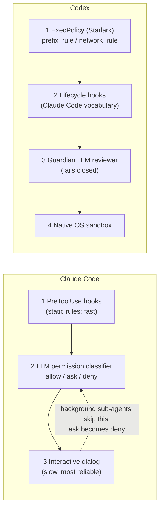

| System | Approach | Distinctive |
|---|---|---|
| Codex | Defense in depth | Starlark rules with inline test examples validated at parse time |
| Gemini CLI | 4 modes: PLAN / DEFAULT / AUTO_EDIT / YOLO | Per-mode TOML policy, env-secret scrubbing |
| OpenHands | Ensemble `SecurityAnalyzer` | Worst case wins; broken analyzers fail closed to HIGH |
| Mistral Vibe | 5-step permission hierarchy | Agent-profile safety classes |
| Hermes | "config.yaml IS the security policy" | **12 hardline patterns survive `--yolo`**; promptware scanning |
| OpenCode | Allow by default in the project | **tree-sitter-parsed bash**; grants scoped by argument count (`git commit *`) |
| Pi | Documented absence | "A partial sandbox would be mistaken for a security boundary" |
| Aider / Mini-SWE | Confirm mode / cost + step caps | — |
| OpenClaw | Scope-based authorization | Operator/node roles; per-method scope checks; rate limits; SSRF policy; DM pairing; 2 MB prompt cap |

**Layer details:**
- **Claude Code:**
  - Denial tracking counts refusals per session and falls back to prompting after a threshold. Each async agent keeps its own denial state.
  - Default foreground sub-agents can still show dialogs. Unresolved cases escalate to the parent coordinator.
- **Codex ExecPolicy:**
  - `prefix_rule(pattern, decision="allow|prompt|forbidden", match, not_match)` and `network_rule(protocol, host, decision)`, loaded from `CODEX_HOME/rules/`.
  - Inline examples are validated at parse time.
  - It is Starlark, not TOML; the April edition got this wrong.
- **Codex hooks:** PreToolUse, PermissionRequest, PostToolUse, PreCompact, SessionStart, UserPromptSubmit, SubagentStart, SubagentStop, Stop, and **PostCompact**, which has no Claude Code counterpart.
- **Codex Guardian:** a separate session re-assesses the exact planned action from a compact transcript and returns a strict-JSON verdict. It fails closed on timeout or malformed output, and has a per-turn rejection circuit breaker.
- **Read-only planning:** with Codex's Plan preset, all 4 vendor systems now have a read-only plan mode.
- **OpenHands analyzers:**
  - `LLMSecurityAnalyzer` (self-rated risk)
  - `GraySwanAnalyzer` (external API)
  - `PatternSecurityAnalyzer`
  - `PolicyRailSecurityAnalyzer`, with shell-AST rails: fetch-to-exec, raw-disk operations, catastrophic delete
  - Ensemble: worst case wins. Risk levels LOW / MEDIUM / HIGH / UNKNOWN. Confirmation modes AlwaysConfirm / NeverConfirm / ConfirmRisky.
- **Gemini modes:**
  - PLAN: read-only; the user approves exit.
  - DEFAULT: dialog per call (once / always / reject).
  - AUTO_EDIT: edits auto-approved, shell commands prompt.
  - YOLO: CI only.

  Releases were dominated by policy and supply-chain hardening: trust-gated `.env` in headless mode, a core-tools allowlist for shell, and path-traversal checks on skill install.
- **Mistral Vibe, 5 steps:**
  1. Per-profile tool setting: ALWAYS / ASK / NEVER.
  2. Tool validators plus a read-only command allowlist.
  3. `hooks.toml` `before_tool` hooks.
  4. Persisted session rules.
  5. Interactive approval, unless `auto_approve` is set.

  Profile safety classes: plan/chat are SAFE, default is NEUTRAL, accept-edits is DESTRUCTIVE, auto-approve is YOLO. `.env` patterns force ASK.
- **Hermes:**
  - Its approval module is 3,200 lines.
  - User deny-globs.
  - A floor of 12 hardline patterns (`rm -rf /`, mkfs, dd to block devices, fork bombs, shutdown) that survives YOLO, with the env var frozen at import.
  - 47 dangerous-command patterns matched on deobfuscated variants.
  - Tirith, an external Rust scanner (cosign-verified).
  - An optional aux-LLM `_smart_approve` (temperature 0, 16 max tokens, APPROVE / DENY / ESCALATE), credited to Codex.
  - Promptware scanning of context files, memory writes, MCP tool descriptions and skills.
  - SSRF guard that always blocks cloud metadata endpoints.
  - **Gaps:** no per-tool allow/ask/deny matrix and no append-only audit log.
- **Pi:**
  - Declares prompt injection via context files unprotectable.
  - The only gate is project trust.
  - A `tool_call` extension event can mutate arguments or block. The reference permission gate is an 80-line example.
  - The session tree serves as the audit trail.
- **OpenCode:**
  - Bash and PowerShell parsed with web-tree-sitter.
  - "Always allow" is scoped by an LLM-generated dictionary of 130 command arities (git 2, npm run 3).
  - Rules are last-match-wins, layered defaults → agent → user → per-agent → session. Denying `"*"` hides a tool from the LLM.
  - A v2 engine is deny-by-default with approvals persisted in SQLite; headless runs auto-reject asks.

Threat-model references: indirect prompt injection, AgentDojo, R-Judge, ToolSword.

---

## 6. Multi-agent orchestration (§11)

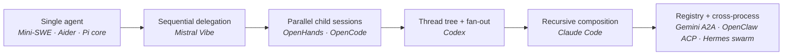

### Claude Code context fork (6 dimensions)

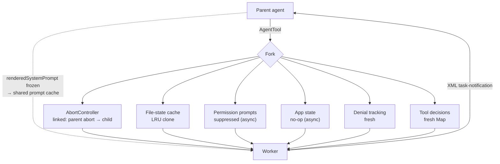

Coordinator mode runs **Research → Synthesis → Implementation → Verification**, and workers get a 16-tool whitelist.

### Codex spawn flow

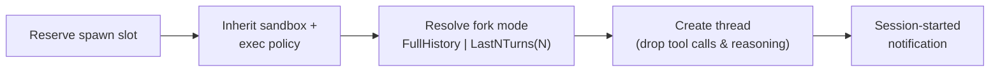

Typed mailbox messages (Spawn / Message / Followup / Result). `spawn_agents_on_csv` creates one sub-agent per CSV row. The `ultra` effort tier combines maximum reasoning with automatic delegation.

**More Codex detail:**
- `keep_forked_rollout_item()` keeps only system, developer and user messages plus final answers.
- There are two tool generations, selected by the `multi_agent_version` model metadata:

  | Generation | Tools |
  |---|---|
  | `multi_agents` | spawn / wait / send_message / interrupt / list |
  | `multi_agents_v2` | spawn / wait / send_input / resume_agent / close_agent |

- Topology is persisted in the `agent-graph-store` crate.
- Roles are declarative TOML: explorer and worker are active; awaiter is unregistered.
- Delegation modes are disabled / explicit-only / proactive.

### Claude Code agent definitions (§11.2.1)

**Schema** (JSON/Zod): description, prompt, tool whitelist/blacklist, model, turn limits, permission mode, MCP bindings, isolation level, background flag, skills.

**Load priority** (later overrides earlier):

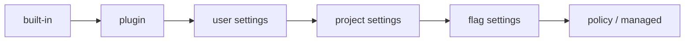

**Built-in agents:** Explore (codebase search), Plan (architecture), VerificationAgent (tests).

**The 16 worker tools** (`ASYNC_AGENT_ALLOWED_TOOLS`): FileRead, WebSearch, TodoWrite, Grep, WebFetch, Glob, Bash, PowerShell, FileEdit, FileWrite, NotebookEdit, Skill, SyntheticOutput, ToolSearch, EnterWorktree, ExitWorktree.

### Table 9: multi-agent mechanisms (full)

| System | Mechanism | Isolation / inheritance | Communication | Depth / parallelism | Tool filtering |
|---|---|---|---|---|---|
| OpenHands | `task` + `delegate` tools, separate conversations | Fresh event log per child; metrics synced back | Summary return; conversation-tree navigation | Nested / concurrent threads | Markdown frontmatter (tools, skills, permission mode) |
| Claude Code | `AgentTool` + context fork | Forked context (6 dimensions), shared rendered prompt | Return value + XML notifications | Recursive / truly parallel | 16-tool whitelist |
| Codex | `spawn_agent` v1/v2 | Thread tree; fork mode | Mailbox input queue; typed records | Depth-tracked / parallel + CSV fan-out | Inherited + filtered; TOML roles |
| Gemini CLI | `invoke_agent`; registry definitions | Isolated tool registry per instance | Symmetric local/remote session protocol; A2A | Flat + remote / sequential within a turn | Per-definition `toolConfig` |
| Mistral Vibe | `task` → new `AgentLoop` | Fresh config + session dir; inherits permissions, scratchpad, hooks | Event forwarding | 1 hop / sequential | Subagent-tagged profiles only (explore) |
| Hermes | `delegate_task` in-process forks; Kanban swarm subprocesses | Fresh context; credentials inherited, history not | Spawn-time goal; streamed events; summary; SQLite blackboard | Depth 1 by default (orchestrator role unlocks more) / 3 concurrent | Intersection with parent + 6-tool blocklist |
| Pi (extension) | Spawns `pi --mode json -p` processes | Hard process isolation | Child JSONL stdout | Unbounded / pool of 4, max 8; chains | Child `--tools` flag |
| OpenCode | `task` → child session (same loop) | `parentID`; inherits only parent deny rules | `<task_result>` XML; background results as synthetic user messages | Recursion off by default / parallel | Permission rulesets |
| OpenClaw | ACP session spawn | Child processes, fresh session | ACP delta events | Recursive / parallel over RPC | Session-scoped |

**Other systems:**
- **OpenHands:**
  - Agents are Markdown + YAML (model, tools, skills, hooks, MCP, permission mode, condenser).
  - Built-ins: code-explorer, bash-runner, web-researcher, general-purpose.
  - Outer `/goal` loop with an LLM judge, plus pluggable critics with refinement caps.
- **Gemini CLI:**
  - Built-in generalist with all tools and a budget of 10 minutes or 20 turns.
  - Invoked via `/agent`, `@agent-name` or the `invoke_agent` tool.
  - `packages/a2a-server`: "A2A is to inter-agent communication what MCP is to tool integration."
- **Hermes:**
  - `delegate_task` defaults: 3 concurrent, 50-iteration budget, depth 1. The blocklist bars recursion, user interaction, memory writes and scheduling.
  - Background delegation re-enters through a completion queue, which preserves the cache.
  - Kanban swarm: planning-root → workers → verifier → synthesizer.
  - `/moa` runs up to 8 advisory reference models.
- **Pi:**
  - The sub-agent extension is about 1,000 lines with single, parallel and chain modes (`{previous}`). No depth counter, no mid-run messaging.
  - An experimental orchestrator package supervises fleets in RPC mode.
- **OpenCode:**
  - Agent schema `mode: primary|subagent|all`.
  - Built-ins: build, plan (edits denied except plan files), general, explore, plus hidden compaction/title/summary agents.
  - Custom agents can be LLM-generated.
- **OpenClaw:** ACP here means the Zed/Google editor protocol, *not* IBM's Agent Communication Protocol.
- **Claude Code vs Codex, overall:**
  - **Claude Code** is compositional and prescriptive.
  - **Codex** was sandboxed and emergent, and is now gaining prescriptive structure (Plan preset, roles, Guardian).
  - What remains different is *where safety is guaranteed*.

> **Obs. 7:** Coordinator-worker emerged independently, and each system optimizes for something different. **Claude Code:** cost. **Codex:** isolation and scale. **Gemini:** portability. **Mistral Vibe:** simplicity. **Hermes:** containment.
>
> **Obs. 11:** For a harness's own sub-agents, 8 of the 9 multi-agent systems stay **in-process**. ACP is used *outward*: for editors, and now for **hosting rival harnesses** (OpenHands runs Claude Code / Codex / Gemini CLI as `step()` backends).

---

## 7. Extensibility (§12)

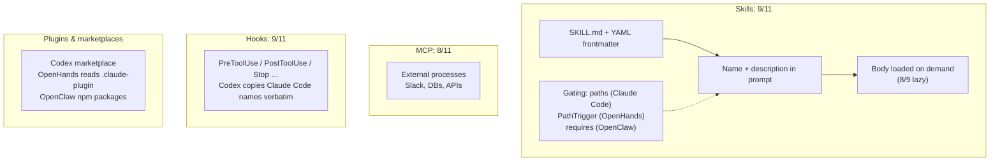

- **`.agents/skills/`** is accepted by 6 systems. OpenCode also searches `~/.claude/skills`.
- **Supply chain:** registries exist in 4 systems; Hermes adds trust tiers, scanning and quarantine; OpenClaw adds provenance verification.
- **Agent-authored skills:** Hermes writes and patches its own skills with a curator. Gemini extracts skills into a review inbox.
- **Pi** is the principled MCP holdout: "build CLI tools with READMEs".

### Plugin architectures (§12.1)

| System | Plugin model |
|---|---|
| OpenClaw | The most mature: standalone npm packages with an `openclaw.plugin.json` manifest, loaded via jiti; Channel / Provider / Skill types; **direct `src/**` imports prohibited** |
| Codex | Marketplace pipeline (GitHub / git / local / URL), `request_plugin_install` tool, `.claude-plugin` compatibility; plugins contribute tools, skills and hooks |
| OpenHands | Plugins bundle skills, hooks, MCP, agents and commands; the loader accepts `.claude-plugin` directories (deliberately Claude Code's format) |
| Claude Code | MCP servers, skills and agent definitions from built-in, custom and plugin sources |
| Pi | TS extensions against 33 typed events (including `before_provider_request` / `after_provider_response`); 78 example extensions that reimplement other harnesses' built-ins; `pi install npm:…\|git:…` |
| OpenCode | Plugins are async functions returning 20 typed hooks; any `.opencode/tool/*.ts` export becomes a tool |
| Gemini CLI | `ExtensionLoader`: extensions add MCP tools, slash commands, hooks, skills and GEMINI.md snippets. An early MCP adopter that supports prompts and resources, not just tools |
| Mistral Vibe | 5 axes: skills, MCP, custom tools (`tool_paths`), prompts/agents (TOML deep-merge), hooks (`before_tool` / `after_tool` / `post_agent_turn`). **An MCP sampling handler lets servers borrow Vibe's LLM**, which no other system offers |

### Configuration layers (§12.2–12.3)

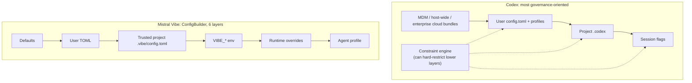

- **Mini-SWE:** Python Protocols (Model, Agent, Environment), no registration needed.
- **Aider:** a data-driven model registry (350+ models).
- **OpenClaw:** a Zod-validated `openclaw.json` with hundreds of nested structures.

### MCP (§12.4)

- **Adoption:** 8 of 11 systems (7 of the 10 coding-first ones): Claude Code, Codex, Gemini CLI, Mistral Vibe, OpenHands, Hermes, OpenCode, OpenClaw.
- **OpenHands:** one `MCPServer` model with 4 transports (stdio, http, streamable-http, sse) and OAuth.
- **Hermes:** the most complete client (resources, prompts, sampling, elicitation, OAuth), and it is also an MCP server.
- **OpenCode:** tools, prompts, resources, templates and OAuth dynamic client registration. Sampling and elicitation are disabled.
- **Pi:** the principled holdout.

### Table 10: skills implementations

| System | Discovery | Invocation | Loading / spec |
|---|---|---|---|
| Claude Code | `.claude/skills/`, `~/.claude/skills/`, dynamic on file edits (`paths`) | `SkillTool` (deferred) | Custom, path-gated; eager + on demand |
| Codex | `core-skills/`, `skills/`, plugin roots | `skills/list` RPC, `$`-mention, implicit detection | Metadata eager under a context-scaled budget; **auto-installs declared MCP/env dependencies** |
| Gemini CLI | `~/.gemini/skills/`, `.gemini/skills/`, `.agents/skills/`, built-ins | `ActivateSkill` (XML + `available_resources`), permission UI | agentskills.io-aligned; installs hardened against path traversal |
| Mistral Vibe | `.agents/skills/`, `.vibe/skills/`, user dirs; trust-gated | `skill` tool (deferred); `/skill-name` | Full agentskills.io; remote registry; built-in self-awareness skill |
| OpenHands | `.agents/skills/`, `.openhands/skills/`, legacy microagents | `<available_skills>` + `invoke_skill` | Progressive disclosure; `PathTrigger`; server CRUD + marketplace API |
| Hermes | `~/.hermes/skills/` (72 bundled + 102 in Skills Hub) | 3-tier disclosure; `skill_view`; skills double as slash commands | Trust-tiered hub; scanning; quarantine; **self-authoring `skill_manage`** |
| Pi | `~/.pi/agent/skills/`, `.agents/skills/`, packages; trust-gated | No tool: `<available_skills>` + ordinary `read` | Lenient agentskills.io; `disable-model-invocation` |
| OpenCode | `skill(s)/**/SKILL.md`, **`~/.claude/skills`**, `.agents/`, remote URL registries | Native `skill` tool (deferred) | Per-skill permission gating |
| OpenClaw | `~/.openclaw/skills/`, `.agents/skills/`, plugins | XML in the system prompt; `/skills` | **Eager** (the only one); gated by `requires` (bins, env, OS); provenance-verified ClawHub |

> **Obs. 8:** Skills overtook MCP (9 vs 8), and the skills layer now has an app-store supply chain.

---

## Claude Code vs Codex: the full pipeline

From the paper's Table 18.

| Stage | Claude Code | Codex |
|---|---|---|
| 1 Prompt | Modular sections; cached static prefix; dynamic suffix | Per-model prompts from server catalog; AGENTS.md root→cwd |
| 2 Tools | 43, deferred via ToolSearch (~40% fewer tokens) | 25–30; `defer_loading` + BM25 search |
| 3 API | Messages API, SSE, `budget_tokens` | Responses API over WebSocket (SSE fallback); effort up to max/ultra |
| 4 Dispatch | Safe tools batched, unsafe run alone, max 10 | `FuturesOrdered`; per-tool `supports_parallel` |
| 5 Permission | Hooks → LLM classifier → dialog | Starlark → hooks → Guardian → sandbox |
| 6 Execution | Host, with opt-in sandbox + worktrees | Always sandboxed (3 OSes) |
| 7 Compaction | 13K buffer; restore 5 files | Token limit; local or cloud compact |

**Residual difference:** the two now organize workflows similarly. They differ in *where safety is guaranteed*: Codex relies on OS enforcement, Claude Code on layered review.
