# Subsystem deep dive: Harness Engineering (arXiv:2609.00006)

← Back to the [main note](README.md). This page gives one section per subsystem (paper §6–12), each with a diagram, a comparison table, and the observation it supports. All numbers come from the paper's July 2026 pins; Claude Code figures come from the March 2026 snapshot.

**Contents:** [1 Loop](#1-agent-loop-6) · [2 LLM integration](#2-llm-integration--prompts-7) · [3 Tools & editing](#3-tools-editing-sandboxing-8) · [4 Memory & context](#4-memory--context-9) · [5 Safety](#5-safety--permissions-10) · [6 Multi-agent](#6-multi-agent-orchestration-11) · [7 Extensibility](#7-extensibility-12) · [Claude Code vs Codex](#claude-code-vs-codex-the-full-pipeline)

---

## 1. Agent loop (§6)

All 11 systems implement ReAct. The paper groups them into three paradigms:

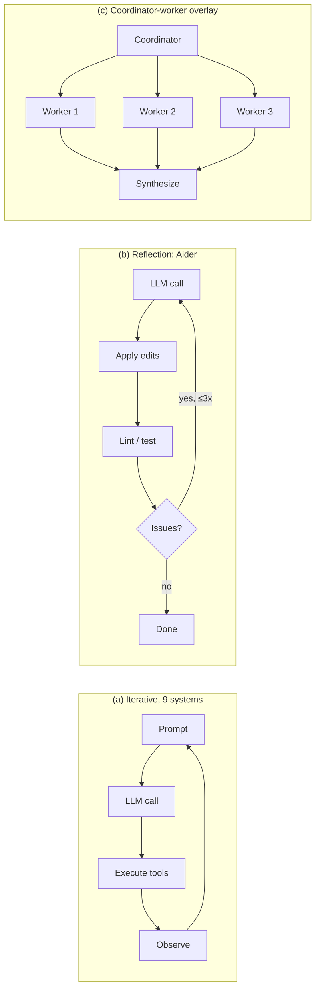

| System | Loop type | Concurrency | Stuck detection | Stop |
|---|---|---|---|---|
| Mini-SWE-Agent | Linear `while` | Sequential | Format-error cap, wall clock | Exit message |
| Aider | Generator + reflection | Sequential | Max 3 reflections | Stream end |
| Claude Code | Streaming + batches | Safety-partitioned (max 10) | None | `end_turn` |
| Codex | Tokio async state machine | `FuturesOrdered` | None | `end_turn` |
| Gemini CLI | Async generator + scheduler | Parallel; edits sequential; model sees `wait_for_previous` | SHA-256 (5 identical calls) + LLM check after 30 turns | `end_turn` / 100 turns |
| Mistral Vibe | Async + middleware stack | `asyncio.create_task` | Turn/price/token middleware | `end_turn` |
| OpenHands | Event-sourced conversation | Resource-locked batches | 5 scenarios | `FINISHED` |
| Hermes | Budgeted `while` + stop guards | 8 workers, safety-gated | Signature hash; warns first, hard stop off | 90-iteration budget; verify-on-stop veto |
| Pi | Functional core + steer/followUp queues | `Promise.all` + per-file queue | None (by design) | `end_turn`, no cap |
| OpenCode | **Log-as-queue** `while(true)` | Uncapped parallel | 3 identical calls → permission ask | No tool calls |

**Notable mechanisms**
- **Claude Code:** `partitionToolCalls()` groups consecutive `isConcurrencySafe` tools (reads) into batches; writes run alone. Safety is opt-in per tool.
- **Mistral Vibe** middlewares: `TurnLimit`, `PriceLimit`, `TokenLimit`, `AutoCompact`, `ContextWarning`, `ReadOnlyAgent`. Policies are layered on top of the loop instead of being branches inside it.
- **OpenCode:** pending spawns and compactions are persisted as message parts, so the loop is **resumable across restarts**.
- **Hermes verify-on-stop:** if code files were changed and there is no fresh verification evidence, a "done" text reply is rewritten into a continuation.
- **Pi truncation-poisoning guard:** if the assistant message was cut off at the length limit, every tool call in it fails without running.
- **Outer loops** ("loop engineering") wrap the inner ReAct cycle: OpenHands `/goal` with an LLM judge, Hermes verify-on-stop.

> **Obs. 1:** Loop sophistication does not predict benchmark score. Production code mass goes to safety, UX, extensibility and clients; about 3/5 of OpenCode's non-test source is clients.

---

## 2. LLM integration & prompts (§7)

### Provider abstraction spectrum

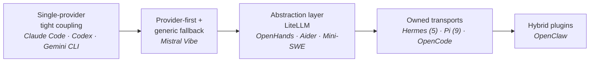

> **Obs. 2:** Caching, thinking and per-model prompts are reachable from *any* point on this spectrum if you pay the per-provider code cost (Hermes, Pi, OpenCode do). What tight coupling still buys is the **update loop**: Codex re-tunes prompts, reasoning tiers and multi-agent tools per model release from a server catalog, with no client release.

### Prompt assembly: the cache boundary idea (Claude Code)

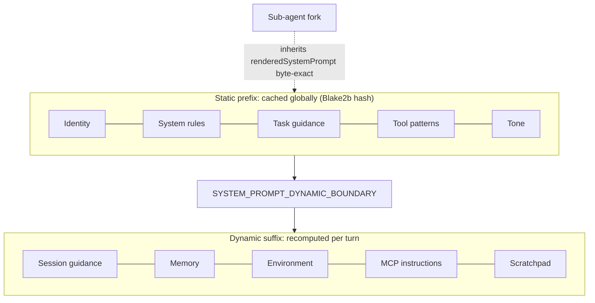

| System | Prompt architecture | Caching |
|---|---|---|
| Claude Code | 12–15 modular sections + boundary | Blake2b static prefix |
| Codex | Per-model prompts **delivered as server data** (`models.json`, GPT-5.2 → 5.6) | `thread_id` cache key |
| Gemini CLI | Capability-gated snippets (modern/legacy) + 3-scope GEMINI.md | None at request level |
| Mistral Vibe | Per-agent Markdown + server-side A/B variants | Git status cached |
| OpenHands | `PromptRegistry`, 18 static sections + dynamic block | STATIC/DYNAMIC tiers |
| Hermes | 3 tiers (stable/context/volatile), model-family-gated blocks | Bit-perfect prefix normalization |
| Pi | One 170-line builder | Breakpoints + TTL + dollar-waste audit |
| OpenCode | 9 base prompts by model family | **6 cache dialects emitted at once** |
| Aider | Polymorphic `CoderPrompts` per edit format | Anthropic markers |
| Mini-SWE | One-shot Jinja2 | Anthropic markers |

### Prompt rhetoric (§7.3)

| Theme | What the prompts say |
|---|---|
| Verbosity | 9/11 have explicit rules. OpenCode: "fewer than 4 lines". Mistral Vibe: "under 150 words". |
| Banned phrases | Mistral Vibe bans "robust", "seamless", "Great!", "Happy to help!" and all emoji. OpenCode's GPT prompt bans "Got it" and em dashes. |
| Anti-gold-plating | Present in 6 scaffolds ("Don't add features… beyond what was asked"). Codex 5.6 dropped it. |
| Read-before-edit | Claude Code and Mistral Vibe state it. OpenCode claims it in the prompt but does not enforce it. Hermes mechanizes verification. |
| Commits | Universal "no commit" in April, split three ways by July. Nobody allows autonomous push or force-push. |
| Emphasis | Three schools: rhetorical (IMPORTANT/NEVER), structural (precedence contracts), example-driven. |
| Refusals | **0/11** prompts contain policy-level harmful-request refusal language; safety is left to the model. |

> **Obs. 3:** Rhetoric converges where experience converges, then thins as trust calibrates, and behavior policy moves from prose into config and feature flags.

---

## 3. Tools, editing, sandboxing (§8)

### Tool count spectrum

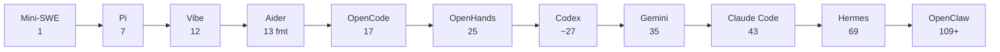

### Deferred tool loading

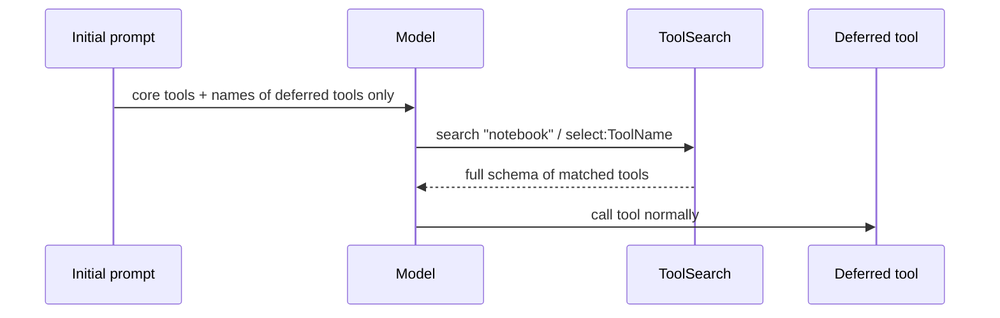

- **Claude Code:** `shouldDefer` + `ToolSearchTool`, about 40% fewer prompt tokens.
- **Codex:** `defer_loading` + **BM25** `tool_search`.
- **Hermes:** once MCP schemas exceed **10% of context**, collapses them into 3 bridge tools (`tool_search` / `tool_describe` / `tool_call`).

### File editing strategies

| System | Format | Matching | Fallback |
|---|---|---|---|
| Claude Code | Exact string replace | Unique substring | Error + context |
| Mistral Vibe | Exact (moved off fuzzy, Apr→Jul) | Unique substring | Ambiguity error |
| Pi | Multi-edit exact | + Unicode/whitespace canonicalization | Uniqueness error |
| Codex | `*** Begin Patch` DSL | Diff hunks | Hunk retry; Lark-grammar variant |
| Gemini CLI | old/new edit | Exact → flexible → regex → fuzzy | **LLM edit-fixer subcall** |
| OpenCode | Patch DSL for GPT, edit for others | 9-stage cascade (Levenshtein 0.65) | Distinct not-found vs ambiguous errors |
| Hermes | SEARCH/REPLACE + V4A | 9-strategy chain ("inspired by OpenCode") | Escalates to `write_file` after 3 failures |
| Aider | 13 formats | Exact → fuzzy (dmp) | Similar-line hints; RelativeIndenter |
| Mini-SWE | sed/awk via bash | Regex | Shell error |

> **Obs. 4:** The edit strategy is a top accuracy lever. Frontier-model harnesses converge on **exact matching**; multi-model harnesses keep **fuzzy cascades**. Lineage is visible in code comments.

### Sandboxing

| Tier | Systems | Mechanism |
|---|---|---|
| Native, 3 OSes | Codex, Gemini CLI | Bubblewrap (vendored in Codex) / Seatbelt / restricted tokens |
| Opt-in OS | Claude Code | Anthropic sandbox-runtime + git worktrees |
| Container backends | OpenHands, Mini-SWE, Hermes (6 backends) | Docker / Apptainer / remote |
| Policy only | OpenCode, Mistral Vibe (worktree opt.) | Permission rules |
| None | Pi (documented), Aider, OpenClaw | — |

> **Obs. 6:** An OS sandbox is a deliberate choice. Hermes (642K lines) and OpenCode (578K) have none and spend on content-borne threat defense and permission granularity instead.

---

## 4. Memory & context (§9)

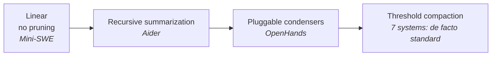

| System | Trigger | Keeps verbatim | Twist |
|---|---|---|---|
| Claude Code | 13K tokens below window | — | Restores 5 files (50K budget) after compaction |
| Gemini CLI | 50% of limit | Last 30% | Context graph, per-file FULL/PARTIAL/SUMMARY/EXCLUDED |
| Pi | window − 16K | ~20K recent | Iterative summary merge; session tree |
| OpenCode | input limit − output reserve | 2 user turns | Merges `<previous-summary>` into fixed sections |
| Hermes | 50% − max tokens (64K floor) | First 3 + tail | **Lineage compaction**: rotates to a child session, keeps history |
| Mistral Vibe | threshold, pre-turn middleware | Prior user msgs re-injected | Also fires reactively on overflow |
| Codex | `model_auto_compact_token_limit` | — | Local or cloud `/responses/compact` |

### Persistent memory: the new frontier

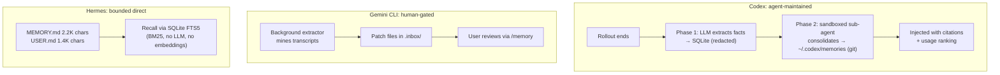

> **Obs. 5:** Compaction has converged. The memory **write path** and its governance are where systems now differ: agent-maintained, human-gated, bounded direct, or pre-turn recall (OpenClaw). None uses embeddings as its primary memory store.

**Repo context:** every system auto-discovers Markdown context files (AGENTS.md, CLAUDE.md, GEMINI.md, .cursorrules). The newer ones read **competitors' filenames** and attach nested files only when tools touch that subtree. Aider has the **only ranked repo map** (tree-sitter + PageRank-style ranking).

---

## 5. Safety & permissions (§10)

### Claude Code: 3 layers vs Codex: 4 layers

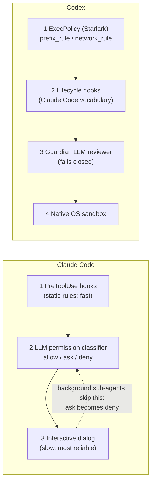

| System | Approach | Distinctive |
|---|---|---|
| Codex | Defense in depth | Starlark rules with inline test examples validated at parse time |
| Gemini CLI | 4 modes: PLAN / DEFAULT / AUTO_EDIT / YOLO | Per-mode TOML policy, env-secret scrubbing |
| OpenHands | Ensemble `SecurityAnalyzer` | Worst case wins; broken analyzers fail closed to HIGH |
| Mistral Vibe | 5-step permission hierarchy | Agent-profile safety classes |
| Hermes | "config.yaml IS the security policy" | **12 hardline patterns survive `--yolo`**; promptware scanning |
| OpenCode | Allow by default in the project | **tree-sitter-parsed bash**; grants scoped by argument count (`git commit *`) |
| Pi | Documented absence | "A partial sandbox would be mistaken for a security boundary" |
| Aider / Mini-SWE | Confirm mode / cost + step caps | — |

---

## 6. Multi-agent orchestration (§11)

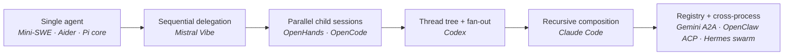

### Claude Code context fork (6 dimensions)

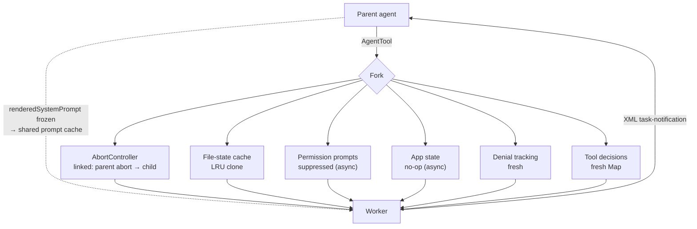

Coordinator mode runs **Research → Synthesis → Implementation → Verification**, and workers get a 16-tool whitelist.

### Codex spawn flow

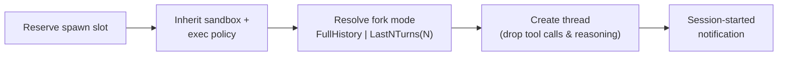

Typed mailbox messages (Spawn / Message / Followup / Result). `spawn_agents_on_csv` creates one sub-agent per CSV row. The `ultra` effort tier combines maximum reasoning with automatic delegation.

> **Obs. 7:** Coordinator-worker emerged independently, and each system optimizes for something different. **Claude Code:** cost. **Codex:** isolation and scale. **Gemini:** portability. **Mistral Vibe:** simplicity. **Hermes:** containment.
>
> **Obs. 11:** For a harness's own sub-agents, 8 of the 9 multi-agent systems stay **in-process**. ACP is used *outward*: for editors, and now for **hosting rival harnesses** (OpenHands runs Claude Code / Codex / Gemini CLI as `step()` backends).

---

## 7. Extensibility (§12)

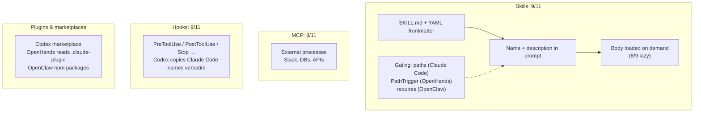

- **`.agents/skills/`** is accepted by 6 systems. OpenCode also searches `~/.claude/skills`.
- **Supply chain:** registries exist in 4 systems; Hermes adds trust tiers, scanning and quarantine; OpenClaw adds provenance verification.
- **Agent-authored skills:** Hermes writes and patches its own skills with a curator. Gemini extracts skills into a review inbox.
- **Pi** is the principled MCP holdout: "build CLI tools with READMEs".

> **Obs. 8:** Skills overtook MCP (9 vs 8), and the skills layer now has an app-store supply chain.

---

## Claude Code vs Codex: the full pipeline

From the paper's Table 18.

| Stage | Claude Code | Codex |
|---|---|---|
| 1 Prompt | Modular sections; cached static prefix; dynamic suffix | Per-model prompts from server catalog; AGENTS.md root→cwd |
| 2 Tools | 43, deferred via ToolSearch (~40% fewer tokens) | 25–30; `defer_loading` + BM25 search |
| 3 API | Messages API, SSE, `budget_tokens` | Responses API over WebSocket (SSE fallback); effort up to max/ultra |
| 4 Dispatch | Safe tools batched, unsafe run alone, max 10 | `FuturesOrdered`; per-tool `supports_parallel` |
| 5 Permission | Hooks → LLM classifier → dialog | Starlark → hooks → Guardian → sandbox |
| 6 Execution | Host, with opt-in sandbox + worktrees | Always sandboxed (3 OSes) |
| 7 Compaction | 13K buffer; restore 5 files | Token limit; local or cloud compact |

**Residual difference:** the two now organize workflows similarly. They differ in *where safety is guaranteed*: Codex relies on OS enforcement, Claude Code on layered review.
