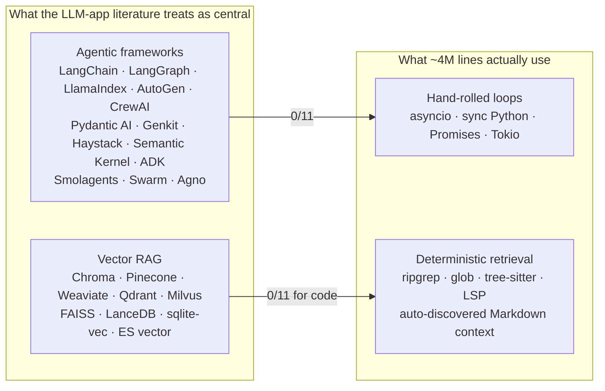
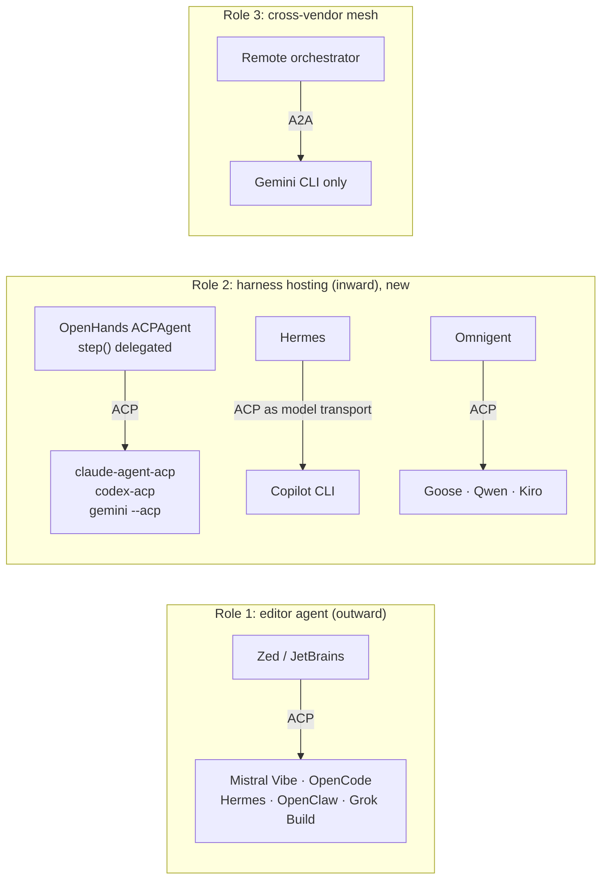
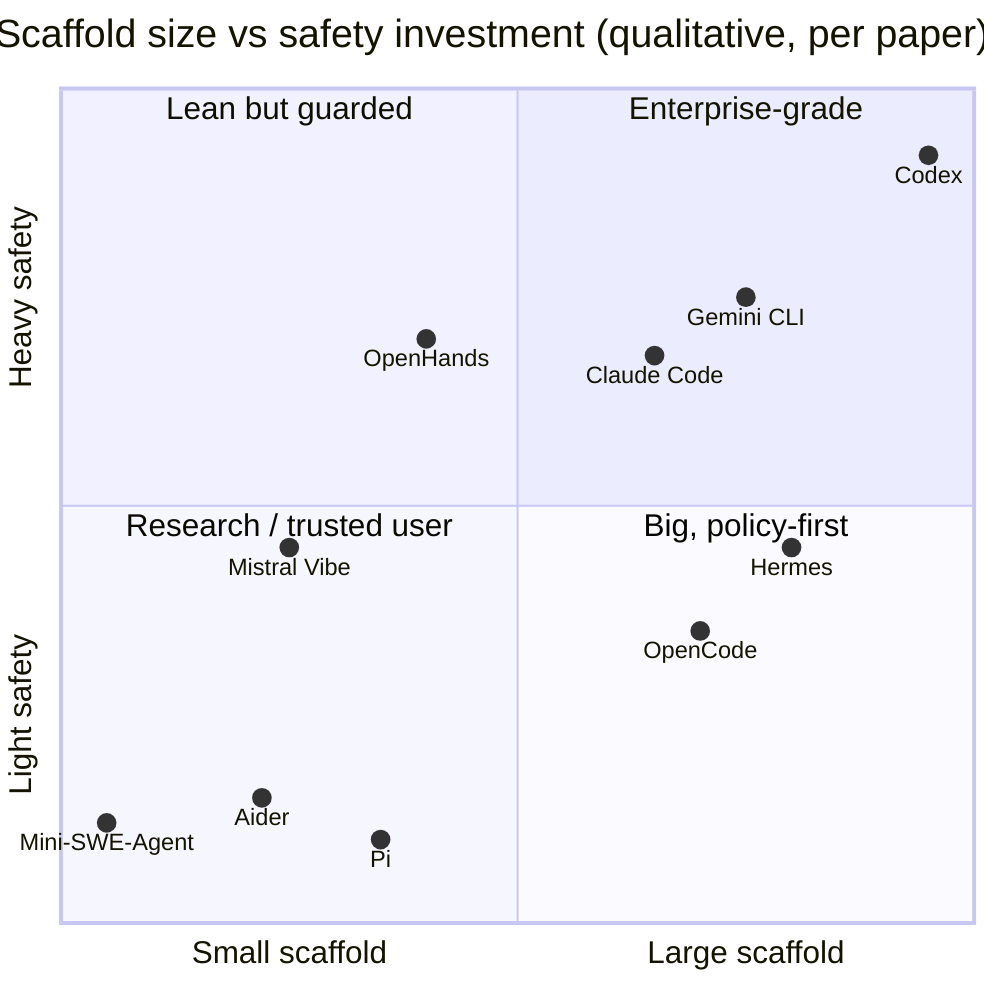
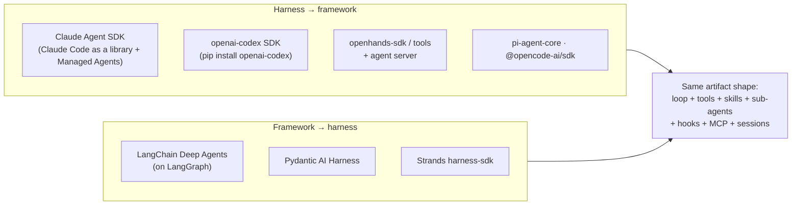
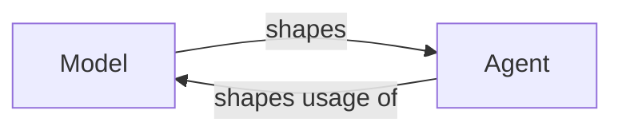
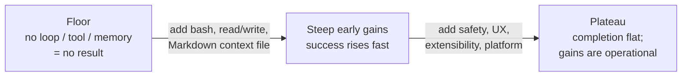
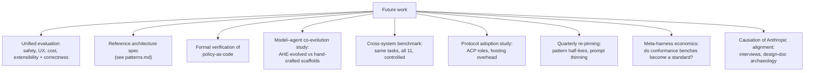

# Synthesis, platform thesis and discussion: Harness Engineering (arXiv:2609.00006)

← Back to the [main note](README.md). Covers §13 (cross-cutting), §14 (platform turn), §15 (discussion) and §17 (conclusion and future work).

---

## 1. The two absences (§13.2)

**How they checked:**
- Read every dependency manifest and grepped every tree for imports.
- Ran the sweep twice, three months apart, across 12 trees.
- Spent several weeks searching for counterexamples: vendored copies, dynamic imports, transpiled builds.

**Boundary cases:**
- **Aider:** `/help` can install `llama-index` to run doc-RAG over Aider's *own docs*. It is opt-in and not part of the loop.
- **OpenCode:** its inner plumbing uses Vercel's AI SDK, a provider-abstraction layer rather than an orchestration framework. A replacement client sits behind a flag, so the dependency looks transitional.
- **Hermes:** its only "LangChain" strings sit inside bundled skill docs.
- **Everything else is custom.** Tool registries are built on Pydantic, Zod, TypeBox, Effect Schema or Rust enums. Prompts are plain Markdown, Jinja2 or string concatenation.

### Table 13: how each system retrieves code

| System | Embeddings? | Code-retrieval mechanism |
|---|---|---|
| OpenHands | No | Grep/Glob tools + terminal; AGENTS.md and .cursorrules ingestion; tree-sitter gone from the SDK |
| Aider | Only the optional `/help` extra | **RepoMap**: tree-sitter symbols, PageRank-style ranking under a token budget |
| Claude Code | No | ripgrep + Bash + on-demand Read; CLAUDE.md auto-discovery |
| Codex | No | Rust-native file search; AGENTS.md concatenated root → cwd |
| Gemini CLI | No | Bundled ripgrep + glob; GEMINI.md; MEMORY.md index; JIT subdirectory context |
| Mistral Vibe | No | ripgrep + tree-sitter (bash parsing) + filesystem search; git status; JIT nested AGENTS.md |
| Mini-SWE-Agent | No | grep through shell |
| Hermes | Opt-in memory plugins only | ripgrep `search_files`; SQLite FTS5 (BM25 + trigram) over sessions; LSP for diagnostics only |
| Pi | No | Auto-downloaded ripgrep + fd; ancestor-walk context files; linear session search |
| OpenCode | No | Bundled ripgrep (100-result cap); 25 auto-downloaded LSP servers for diagnostics, no index |
| OpenClaw | Hybrid sqlite-vec KNN + FTS5 **for chat memory only** (OpenAI embedder by default) | N/A; filesystem APIs |

**Why the absences hold, according to the paper:**
1. **Frameworks** "create extra layers of abstraction that obscure prompts and responses" (Anthropic, Dec 2024). Once the agent is mutating real code, failure modes such as silent prompt corruption, opaque caching and version-incompatible tool schemas become too costly to tolerate.
2. **Code RAG:**
   - Code has dense deterministic structure (paths, LSP, parse trees) that similarity search can't replicate.
   - Code changes minute to minute, so embeddings are stale by construction.
   - ripgrep is already near-optimal.
   - CodeRAG-Bench shows gains are highly task-dependent: real for doc lookup, marginal otherwise.

> **Historical resolution (§14.2):** harnesses didn't adopt frameworks. They *replaced* them, then became importable themselves.

---

## 2. Inter-agent protocols: three roles for ACP (§13.3)

### Table 14: how a main agent talks to its sub-agents

| System | Main ↔ sub-agent | Protocol roles | Sub-agents cross processes? |
|---|---|---|---|
| Claude Code | AgentTool call + context fork + XML notifications | None at agent layer (ACP via a separate adapter binary) | No |
| Codex | Session input queue with mailbox phases; typed records | None (external codex-acp) | No |
| Gemini CLI | `invoke_agent` behind a local/remote session protocol | A2A server (mesh) | No |
| Mistral Vibe | `task` tool, in-process asyncio | ACP server (editor; rewind over protocol) | No |
| OpenHands | Task/delegate tools, concurrent threads | ACP client/host: rival harnesses as backends | No |
| Hermes | In-process thread forks; swarm over SQLite blackboard | ACP server + client | Swarm: yes (database, not protocol) |
| Pi | Extension spawns OS processes, JSONL over stdio | Proprietary JSONL RPC (~30 commands); no ACP, A2A or MCP, by design | Yes (extension) |
| OpenCode | `task` tool, in-process child sessions | ACP server (stdio ndjson) | No |
| OpenClaw | ACP session spawn over RPC | ACP both inward and outward | Yes |

**Guidance from Observation 11:** build an ACP server, because it now serves editors, hosts and meta-orchestrators at once. Keep sub-agents in-process. Treat A2A as an unproven bet. Pi rejects the standards yet still invents its own outward RPC, which suggests the outward pressure is real.

---

## 3. The five trade-off axes (§13.4)

*The positions are my qualitative reading of the paper's descriptions. The paper does not score them.*

| Axis | One end | Other end | Point |
|---|---|---|---|
| 1 Simplicity ↔ Capability | Mini-SWE (74%+ self-reported) | Codex (69.1%, sandboxed) | The extra code goes to safety, UX, extensibility and robustness, not task logic. Not comparable head to head |
| 2 Safety ↔ Autonomy | Codex, Claude Code (more friction) | Mini-SWE, Aider (faster, not enterprise-ready) | |
| 3 Provider coupling ↔ Agnosticism | Claude Code, Codex (caching, thinking, model prompts) | LiteLLM systems (flexibility) | |
| 4 Monolithic ↔ Modular | Codex (126 crates, 1M lines of Rust) | Mini-SWE (single file) | Pi moves the axis into runtime composition; OpenCode is embeddable through client/server |
| 5 Scaffold ↔ Model capability | — | — | "Most philosophically interesting": models already succeed with minimal scaffolds. Production scaffolding is for *users* (safety, reliability, workflow) |

---

## 4. The platform turn (§14)

### Four signals that the CLI is now the framework (§14.1)

| Signal | Evidence |
|---|---|
| 1 Skills as declarative programs | 9/11 systems. A skill is "a program written for an LLM runtime": English plus YAML that says what to do, when to activate and which tools to use |
| 2 Hooks and event buses as the extension substrate | 9/11. Codex uses Claude Code's event names verbatim; OpenHands hooks in `Agent.step()`; Vibe uses `hooks.toml`; Gemini has 11 events; Pi has 33 typed events; OpenCode has 20 hooks |
| 3 The boundary between tool and workflow disappears | The agent loop *is* the workflow engine: coordinator phases, `update_plan` + `/goal`, judge-audited goal loops |
| 4 The harness as a service surface | OpenCode: HTTP + OpenAPI + generated SDK. OpenHands: OpenAI-compatible gateway ("the agent as a model"). Vibe teleports sessions to hosted runtimes. Claude Code: SDK + Managed Agents API |

> The developer's "program" is a natural-language task plus a tree of Markdown files (CLAUDE.md, AGENTS.md, GEMINI.md, SKILL.md). The "API" is the filesystem, the terminal and git.

### The harness–framework merger (§14.2, Table 15)

### Platform economics (§14.3)

| Mechanism | Evidence |
|---|---|
| **Marketplaces** | Codex plugin marketplace (GitHub, git or URL sources; in-conversation install approval; workspace sharing). Skill registries in 4 systems with trust tiers, provenance and quarantine. OpenClaw plugins on npm. App-store security problems are already showing up (SkillProbe) |
| **Switching costs** | Codex imports `~/.claude/projects` session JSONL and translates `~/.claude/settings.json` → `~/.codex/config.toml`. On the other side: OpenCode reads Claude skills and OpenHands reads Claude plugins. "User data becomes the moat" |
| **Enterprise governance** | Codex config sits above the user: MDM, host-wide and cloud-delivered bundles, plus a constraint engine that can hard-restrict user and project scopes. Google closed-sourced its successor CLI and gated the free tier |
| **Acquisition-scale pricing** | SpaceX–xAI merger; $60B Cursor deal pending |

### Ninety days in numbers (§14.5)

| System | April → July |
|---|---|
| Codex | 621K → 1.12M lines of Rust; 89 → 126 crates (memories, Guardian, marketplace, code mode, realtime voice) |
| Mistral Vibe | 35.6K → 63K lines (+77%) |
| OpenHands | Re-architected into an SDK; the app repo became an automation control center |
| Gemini CLI | Brand pivot announced; free tier gated |
| Aider | 18 commits in the window (community maintenance) |

**Three April observations revised in place:**
- the coupling dichotomy (Obs. 7.1)
- the claim that size implies a sandbox (Obs. 10.2)
- the protocol placement story (Obs. 13.3)

---

## 5. Discussion (§15)

### Anthropic guidance vs observed code (§15.1)

| Anthropic prescription | Source | Observed in corpus |
|---|---|---|
| Don't use frameworks unless necessary | Building Effective Agents | 0/11 use one |
| ACI matters as much as HCI; few thoughtful tools | Building Effective Agents; Writing Effective Tools | Aider's 13 formats, Claude Code's deferred loading, Codex's patch DSL, Hermes's 9-strategy chain, OpenCode's per-model tools |
| Just-in-time retrieval over RAG | Effective Context Engineering | 0/11 embed code |
| Orchestrator-workers for parallel, context-spanning work | Multi-Agent Research System | 7 systems (8 counting OpenClaw) |
| Save plans to external memory before spawning | Multi-Agent Research System | CLAUDE.md, Gemini plan files and MEMORY.md, Codex AGENTS.md and memories |
| Compaction + structured notes + sub-agents for long horizons | Effective Context Engineering | All 4 vendor systems and all 3 newcomers implement all three |
| Multi-agent costs ~15× chat tokens | Multi-Agent Research System | Motivates cache-sharing forks (Claude Code, Hermes) and Gemini's thought-stripping |

**The tension:** Anthropic says "most coding tasks involve fewer truly parallelizable tasks than research." Yet 7 systems build coordinator-workers for coding. **Resolution:** in practice these are used mainly for *breadth-first exploration* (parallel code research), not parallel implementation.

### The minimalism argument (§15.2)

Mini-SWE-Agent reports 74%+ with one bash tool, which echoes CodeAct: executable code subsumes tools. Benchmarks don't reward what production systems pay for:

- **safety:** preventing destructive actions
- **UX:** streaming, TUIs, progress tracking
- **extensibility:** custom tools, MCP, plugins
- **robustness:** edge cases, stuck detection, error recovery
- **cost management:** caching, compaction, model selection

### Safety as architecture (§15.3)

| System | Position |
|---|---|
| Codex | Defense in depth from day one: OS sandbox + policy-as-code + approvals |
| Gemini CLI | Lighter: cross-platform sandbox reusing OS binaries + 4 approval modes + per-mode TOML |
| Claude Code | Between automation and oversight: hooks → classifier → dialog |
| Mistral Vibe | Granular scopes, no OS enforcement |
| OpenHands | Pluggable rule-based and LLM analyzers |
| Hermes, OpenCode | Comparably large, with no OS isolation; spend on content threats and permission granularity |
| Aider, Mini-SWE | Fine for trusted developer use, limited for enterprise and automation |

### Model–agent co-design runs both ways (§15.4)

| Direction | Examples |
|---|---|
| **The model shapes the agent** | Codex's server-delivered per-model prompts (GPT-5.2 → 5.6). Claude Code's thinking budgets. Gemini's ModelRouter picks the cheapest sufficient model (absorbed the 2.5 → 3.x shift in one quarter; cf. RouteLLM, FrugalGPT, Hybrid LLM). Vibe's `reasoning_effort`. Aider and OpenCode pick edit formats per model. OpenHands ships tool presets per model |
| **The agent shapes model usage** | Deferred tools shrink the effective prompt. The cache boundary organizes the prompt around cache economics. Gemini keeps thinking out of history. Vibe's middleware composes token budgets. OpenHands condensers decide what the model "remembers" |

**Implication:** multi-provider systems *can* reach the full optimization menu, as Hermes, Pi and OpenCode show. What they can't replicate is the **update loop**: only the vendor can re-tune server-side on model-release day.

### The scaffold–capability frontier (§15.5), a guiding intuition

*The curve is roughly concave. The paper gives no numbers for it and explicitly labels it a hypothesis, not a result.*

- **Floor:** no loop, no tool, no result.
- **Steep early gains** from a bash tool, read/write and a Markdown context file.
- **Plateau:** past that point, scaffold work pays off in safety, UX and extensibility, not completion rate.
- **Consistent with:** Mini-SWE's 74%+, and AHE's ablation (tools, middleware and memory help; the system prompt alone regresses; the evolved harness transfers across 4 model families). So *structural* scaffold seems more portable than prompt prose.
- **What a test would need:** a fixed task distribution, a fixed model, a scaffold-complexity metric (LoC, tool count, or feature count) and a target success rate. The minimum viable scaffold is the lower envelope. It likely varies with task complexity, safety requirements and interaction length.

### Threats to validity (§15.6)

| Threat | Detail |
|---|---|
| Source reading, not runtime | No speed or performance claims; benchmark numbers are self-reported |
| Judgment calls | Qualitative scoring; no line-number citations on purpose (they'd be obsolete); all sizes dated to the July pins |
| Claude Code reproducibility | Circulated March 2026 snapshot vs the evolving binary; checkable against `claude-agent-sdk` and observed behavior |
| Framework-absence check is conservative | Manifest and import grep only; dynamic imports, internal forks and transpiled builds not traced. "Surprised, but not shocked" |
| Anthropic mapping is not causal | Would need interviews with vendor engineers |
| No shared-task execution | A head-to-head run would cost about 10× the effort of this study |
| Inventory vs structure | Inventory claims are now dated; structural claims are expected to last |

---

## 6. Conclusion (§17)

### Nine key takeaways (§17.1)

1. **Architecture matters, but not the way the discourse implies.** Loop sophistication doesn't predict benchmark scores; it predicts production readiness.
2. **Co-evolution and the update loop.** Coupling is about who controls the update loop, not capability.
3. **Safety is expensive, and a choice.** It is not a consequence of scale.
4. **Multi-agent converged on hierarchy.** ACP found a third role (hosting); sub-agents stay in-process in 8/9 systems.
5. **Skills lead MCP** (9/11 vs 8/11), with registries, trust tiers and agent authors.
6. **The two absences are real, re-verified and historically explained** by the merger.
7. **Anthropic's series anticipated the architectures.** Causation is open.
8. **Actionable output:** 18 recommendations and a 90-line scaffold.
9. **The platform turn is complete.** SDKs, marketplaces, importers, MDM governance, agent-as-a-model, a meta-harness, and lock-in becoming structural, as with operating systems and IDEs.

### Future work (§17.2)

**Disclosure (Acknowledgments):** the paper was written with substantial help from Claude via Claude Code CLI, and the findings were verified against the codebases. The acknowledgments mention "twelve codebases," meaning the 11 systems plus Omnigent.
